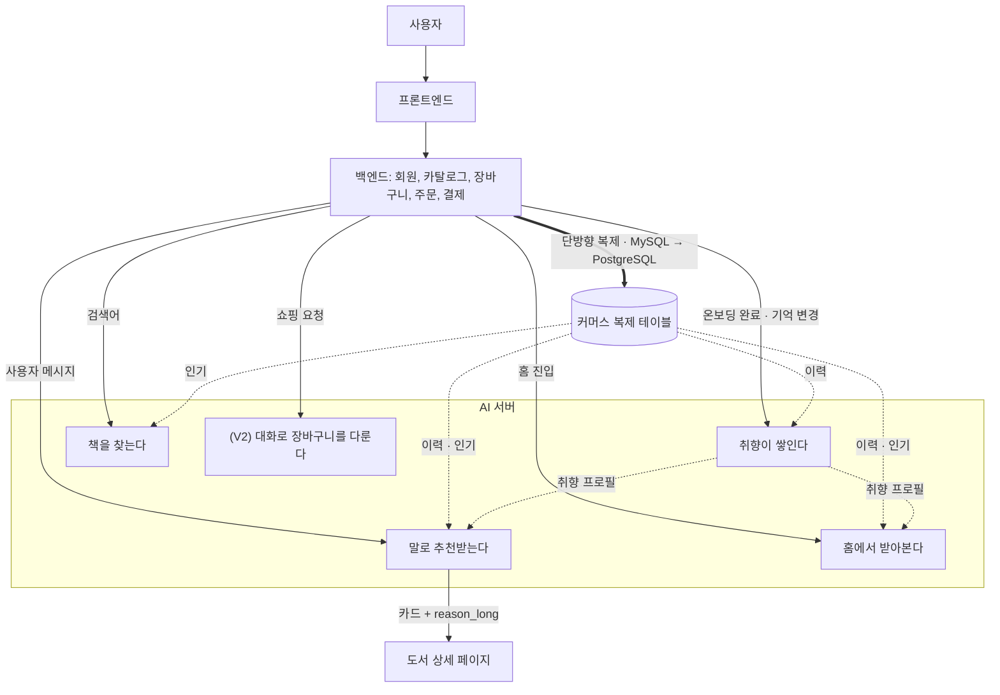

**요약** BE ↔ AI 구간의 엔드포인트 9개와 공통 규약을 정의한다.

책 커머스 “북적북적”의 AI 서버 API 명세다.

## 목차

1. 엔드포인트 목록
2. 입력/출력 형식 명세
3. 서비스 구조에서의 역할과 연동
4. API 호출 예시와 예시 응답
5. 공통 규약

## 1. 엔드포인트 목록

**BE → AI**. 백엔드가 호출한다.

| # | 메서드/경로 | 기능 | 버전 |
|---|---|---|---|
| ① | `POST /search` | 검색어로 도서를 조회한다 ¹ | V1 |
| ② | `POST /embeddings` | 글을 벡터로 바꾼다. 검색어와 도서 정보 모두 이 API를 쓴다(내부 전용) | V1 |
| ③ | `POST /recommendations/chat` | 챗봇이 대화로 책을 추천한다 ² | V1 (이미지 턴 V2) |
| ④ | `GET /recommendations/feed` | 사용자 취향 프로필로 개인화 추천 목록을 만든다. 검색어를 받지 않는다 | V1 |
| ⑤ | `POST /preferences/extractions` | 밤에 한 번, 그날 끝난 대화에서 취향을 뽑아낸다(동의한 사용자만) | V2 |
| ⑥ | `POST /preferences/profile` | 온보딩 응답과 취향 기억으로 취향 프로필을 생성한다 ³ | V1 |
| ⑦ | `POST /agent/act` | 사용자 메시지에서 쇼핑 의도를 해석해 백엔드 tool을 실행한다 ⁴ | V2 |
| ⑧ | `GET /health` | 서버와 구성 요소의 가용 상태를 반환한다 | 공통 |
| ⑨ | `POST /recommendations/feed/refresh` | 밤 배치 맨 끝에, 임시로 채운 자리가 있는 추천 목록을 다시 뽑는다 | V2 |

¹ 키워드 검색과 벡터 검색 순위를 합친다. 결과가 0건이면 대화형 추천으로 전환하라는 신호를 함께 반환한다

² 사용자 메시지를 읽어 추천 조건을 갱신하고 카드를 최대 3장 준다. 카드마다 한 줄 이유와 상세 페이지용 긴 이유를 한 번의 LLM 호출로 함께 만든다. (V2) 사진을 보내면 같은 요청에서 표지를 인식한다. 쇼핑 칸(`idempotency_key` 등)을 함께 보내면 AI 서버가 추천과 쇼핑을 가른다 ⁴

³ 만들 때는 POST, 고칠 때는 PUT으로 부른다(AI #303). 구매·도서관·리뷰는 요청의 `history`로 받고, 보내지 않으면 아래 복제 테이블에서 직접 읽는다(AI #327). 호출할 때마다 전체를 다시 계산한다

⁴ **BE는 ⑦을 직접 부르지 않는다.** 추천인지 쇼핑인지는 AI 서버가 가른다(AI #413). BE는 ③ 하나만 부르고, 쇼핑에 필요한 칸을 ③ 요청에 실어 보낸다. 응답의 `route`로 어느 쪽 응답인지 안다. `/agent/act`는 같은 처리를 직접 부르는 입구로 그대로 남는다

**AI → BE**. 반대 방향의 **호출은 없다.** ⑦ 쇼핑 에이전트도 BE를 부르지 않는다(AI #489). BE가 ③ 요청에 그 사용자의 장바구니(`cart`)와 카드 책의 가격, 재고(`offers`)를 실어 보내고, AI는 그 값으로 이번 턴만 쓰는 장바구니 복사본을 만들어 처리한 뒤 **바꿀 것 목록(`actions`)** 을 응답으로 돌려준다. 검증과 실제 변경은 BE가 한다. 그 밖에 ⑤의 `extractions[]`와 ③의 `reason_long`이 **응답 본문**으로 나가 BE가 저장한다. **DB 복제는 BE→AI 한 방향뿐이고 역방향 복제 채널은 없다.**

⑦의 tool은 모두 AI 서버 안에서 처리한다. 장바구니 tool은 요청으로 받은 복사본을 읽고 바꾼다.

| tool | 기능 | 성격 | 제약 |
|---|---|---|---|
| cart.view | 장바구니 목록(책, 가격, 수량, 구매 가능 여부). 요청의 `cart`를 읽는다. 합계는 AI가 계산한다 | 읽기 | - |
| cart.add | 장바구니 담기(이미 담긴 책은 사용자가 수량을 말했을 때만 그 수량으로 바꾼다) | 쓰기 | 수량 1~500, 서로 다른 책 30권까지. 재고, 권한은 BE가 반영할 때 다시 확인 |
| cart.update | 담긴 책의 수량 변경. 0은 허용하지 않는다 | 쓰기 | 재고는 BE가 반영할 때 다시 확인 |
| cart.remove | 장바구니에서 빼기 | 쓰기 | - |
| book.offer | 요청의 `offers`와 `cart`로 isbn마다 가격, 재고(price, in_stock)를 답한다(모르는 책은 빠진다) | 읽기 | - |

- **쓰기 tool은 BE 장바구니를 바꾸지 않는다.** 복사본에서 바뀐 것을 턴이 끝날 때 `actions`로 모아 돌려준다. 책은 ISBN으로 가리키고, BE가 반영할 때 상품과 장바구니 항목 번호로 바꾼다.
- **그 밖의 tool 3개도 AI 서버 안에서 처리한다.** `selection.pick`(예산, 권수 조합 고르기), `book.compare`(비교, 소개글은 AI DB의 책 표에서 읽는다), `ui.guide`(화면 이동 버튼 붙이기)이다. `tool_calls[]`에는 기록된다.
- **인증**. AI가 BE를 부르지 않으므로 AI→BE 서비스 토큰은 없다. 누구 장바구니인지는 BE가 요청을 보낼 때 정하고, `actions`를 반영할 때 그 사용자의 권한으로 다시 확인한다.

## 용어

이 문서에서만 쓰는 말과, 뜻을 좁혀 쓴 말만 모았다.

- **턴(turn)**: 사용자 메시지 한 번과 그에 대한 응답 한 번. 텍스트 턴 = 글, 이미지 턴 = 사진
- **spec(추천 조건)**: 챗봇이 지금까지 파악한 추천 조건. 6개 키를 가진 객체다. 서버가 대화를 저장하지 않으므로 클라이언트가 매번 함께 보내고 돌려받는다
- **공통 응답 형식(envelope)**: 모든 응답을 같은 모양으로 감싼다. { message, data }
- **커서(cursor)**: 목록에서 “여기까지 봤다”를 가리키는 표식. 서버가 만들어 주며 클라이언트는 내용을 해석하지 않고 그대로 되돌려 보낸다
- **멱등 키(idempotency key)**: 같은 요청이 재시도로 두 번 와도 한 번만 실행되게 하는 키
- **축소 응답(degraded)**: 일부 기능이 죽었을 때 에러를 내지 않고 기능을 줄여서라도 정상(200)으로 응답하는 것. X-Degraded 헤더로 알린다
- **업스트림(upstream)**: AI 서버가 호출하는 외부 모델 서비스(LLM, 임베딩)
- **centroid(취향 벡터)**: 사용자 취향을 대표하는 벡터. 좋아한 책, 태그, 기억 벡터의 가중평균이다
- **Pre-signed URL**: 만료 시간이 있는 임시 접근 URL. 이미지 업로드에 쓴다
- **tool**: AI가 백엔드에 요청하는 기능 단위(장바구니 담기 등). V2 쇼핑 에이전트 전용
- **복제 테이블**: BE MySQL의 커머스 데이터를 AI PostgreSQL로 단방향 복제한 사본. 도서 카탈로그, 구매, 나의 도서관, 리뷰, 인기 집계. 원본의 주인은 BE이고 AI는 자기 사본을 읽기만 한다. 이름의 `v_` 접두사는 표기일 뿐 view가 아니다
- **복제 지연(lag)**: BE 원본의 변경이 AI 복제본에 도착하기까지의 시간. 지연 중에는 아직 도착하지 않은 행이 있을 수 있다. 오류가 아니고 축소 응답도 아니다
- **신선도 예산**: 복제본이 원본보다 얼마나 늦어도 되는지 테이블마다 정한 값. ERD §2에 전체 목록이 있다
- **이력**: 한 사용자의 구매, 나의 도서관 담기, 리뷰를 묶어 부르는 말. 피드 규칙 점수의 항 이름이기도 하다
- **인기**: 도서 단위 집계값. MVP는 최근 판매 수 단일 기준이다(BE #68 합의). 리뷰 반영 공식은 BE가 복제 칼럼으로 주면 그때 반영한다. v_book_popularity 하나에서만 읽는다

## 2. 입력/출력 형식 명세

<details><summary>① <code>POST /search</code> — AI 검색</summary>

키워드 검색과 벡터 검색을 각각 수행한 뒤, 제목이 검색어와 (공백 빼고) 똑같은 책을 맨 앞에 놓고 나머지는 두 순위를 RRF로 합쳐 최종 순위를 만든다. LLM을 호출하지 않는다. 요청에 담긴 필터와 정렬만 적용하며, 검색어에서 조건을 추출하지 않는다.

**입력**

```json
{
  "query": "김영하 여행의 이유",
  "filters": {
    "category": "에세이",
    "price_min": 10000,
    "price_max": 20000,
    "pub_year_from": 2020,
    "pub_year_to": 2026
  },
  "sort": "relevance",
  "cursor": null,
  "size": 15
}
```

| 필드 | 타입 | 필수 | 설명 |
|---|---|---|---|
| query | string | Y | 검색어. 1–200자 |
| filters | object | N | 조회 조건. 이 값만 적용하고 검색어에서 조건을 추출하지 않는다 ¹ |
| filters.category | string | N | 온보딩 관심 분류(소설, 에세이 등 14개). 대응표의 핵심 카탈로그 분류들로 거르고, 그 밖의 값은 400 ² |
| filters.price_min, .price_max | int | N | 판매가 구간(원) |
| filters.pub_year_from, .pub_year_to | int | N | 출간연도 구간 |
| sort | enum | N | relevance(기본, 관련도), newest, price_asc, price_desc, popular(판매 수 기준, BE #68 합의) |
| cursor | string? | N | 페이지 커서. 직전 응답의 next_cursor를 그대로 싣는다. 첫 턴은 생략. 30분 지나면 만료 |
| size | int | N | 한 페이지 개수. 기본 15, 최대 50 |

¹ 재고 조건(in_stock_only)은 없앴다(AI #335). 실려 와도 400이 아니라 무시한다

² 어린이는 여러 분류에 흩어져 있어 분류로 가를 수 없다. 400이 아니라 거르지 않은 결과를 준다(AI #228)

**출력** `200`

```json
{
  "message": "search_success",
  "data": {
    "results": [
      {
        "book_id": 2077,
        "isbn": "9788900000073",
        "title": "여행의 이유",
        "author": "김영하",
        "publisher": "문학동네",
        "price": 13500,
        "in_stock": true,
        "cover_url": "https://…/2077.jpg"
      }
    ],
    "next_cursor": "eyJ…(서명됨)",
    "fallback": null
  }
}
```

**0건 응답**. 대화형 추천으로 전환할 수 있다는 신호를 함께 반환한다. 서버는 전환을 수행하지 않는다.

```json
{
  "message": "search_success",
  "data": {
    "results": [],
    "next_cursor": null,
    "fallback": {
      "message": "원하는 책을 못 찾았어요. AI 추천에게 물어볼까요?"
    }
  }
}
```

| 필드 | 타입 | 설명 |
|---|---|---|
| results | object[] | 검색 결과. 없으면 []. 키워드 200권+벡터 50권 후보 안에서만 나와 최대 약 250권 |
| results[].book_id | int | 도서 ID |
| results[].isbn | string? | ISBN-13. 책 표에 ISBN이 없는 도서는 null ¹ |
| results[].title | string | 제목 |
| results[].author, .publisher | string? | 저자, 출판사. 카탈로그에 값이 없는 도서는 null |
| results[].price | int? | 판매가(원). 할인 적용 후. 상품이 없는 도서는 null |
| results[].in_stock | bool | 재고 여부. 상품이 없는 도서는 false |
| results[].cover_url | string? | 표지 이미지 URL. 없는 도서는 null |
| next_cursor | string? | 다음 페이지 커서. 마지막이면 null. 다음 요청의 cursor에 그대로 싣는다 |
| fallback | object? | 결과가 0건일 때만 값이 있고 그 외 null |
| fallback.message | string | 호출자에게 전달할 안내 문구 |

¹ 책 번호를 ISBN으로 옮기는 중이라 book_id와 함께 싣는다(AI #313). 다 옮기면 book_id를 뺀다

**에러**

| 상태 | message | 언제 |
|---|---|---|
| 400 | invalid_request | 형식, 길이, 범위 위반(query 1–200자, size 최대 50, category가 온보딩 값이 아님 등) |
| 401 | unauthorized | 서비스 토큰 없음, 불일치 |
| 410 | cursor_expired | 커서가 만료됐거나, 검색어, 필터, 정렬, 축소 모드가 커서 발급 시점과 다름. 첫 페이지부터 다시 요청 |
| 413 | payload_too_large | 요청 본문이 64KB 초과 |
| 429 | rate_limited | V1은 내지 않는다(호출 한도를 두지 않음) |
| 500 | internal_server_error | 서버 내부 오류 ¹ |
| 200 | search_success, X-Degraded: keyword-only | 벡터 검색 불가 ² |

¹ 키워드 검색이 실패하면(AI Postgres 장애 등) 벡터 결과와 상관없이 500. BE MySQL 장애는 해당하지 않는다

² 키워드 검색 결과만 반환한다. 임베딩 업스트림 장애, 벡터 인덱스 이상, 초기 적재 중일 때 나온다. 복제 지연·행 부재는 해당하지 않는다

- `popular`(인기순)은 `v_book_popularity`의 최근 판매 수로 산출한다(MVP, BE #68 합의). 챗봇의 후보 채점, 피드의 인기 항, cold_start 목록도 같은 테이블을 읽는다. 리뷰까지 반영한 공식은 BE가 복제 칼럼으로 주면 그때 반영한다.
- 검색은 개인화하지 않으므로 사용자 이력(구매, 도서관, 리뷰)을 읽지 않는다. 누가 검색하든 같은 순위다. 인기는 사용자와 무관한 도서 단위 값이라 이 원칙을 깨지 않는다.

</details>

<details><summary>② <code>POST /embeddings</code> — 텍스트 임베딩</summary>

텍스트를 벡터로 변환한다. 내부 전용이며 검색어와 도서 정보 모두 이 API를 쓴다. 한 번에 최대 256건이므로 대량 적재는 나눠서 호출한다.

벡터 길이는 응답의 `dim`으로 알려준다. 호출자는 이 값이 자신이 쓰는 벡터 인덱스의 차원과 같은지 확인한 뒤 저장해야 한다.

벡터는 `multilingual-e5-small` 384차원이다(ERD §5).

**초기 적재**

서비스 시작 시점과 임베딩 모델 교체 시점에 카탈로그 전체의 벡터를 한 번에 만든다.

1. BE 카탈로그가 `v_books`로 전량 복제된다. **복제가 끝나기 전에는 임베딩을 만들지 않는다** — 대상 목록이 확정되지 않는다.
2. `description`이 있는 행을 `book_id` 순으로 256건씩 나눠 호출한다. 카탈로그 N권이면 `ceil(N / 256)`회.
3. 응답의 `dim`을 확인한 뒤 `book_embeddings`에 upsert한다. `description`이 없는 도서는 벡터 검색 대상에서 빠지고 키워드 검색으로만 조회된다.
4. 중단되면 행이 없는 `book_id`부터 다시 시작한다. upsert라 중복 실행이 결과를 바꾸지 않는다.

적재 중에도 검색은 응답한다. 벡터 결과가 부족한 동안 `X-Degraded: keyword-only`가 나가며, 이는 임베딩 장애 때와 같은 상태라 BE가 추가로 할 일은 없다. 신간도 복제 후 같은 절차를 타며, 두 단계를 합친 허용 지연은 `ERD §3의 신선도 예산`을 따른다.

**입력**

```json
{ "texts": ["쓸쓸하고 담담한 위로"], "purpose": "query" }
```

| 필드 | 타입 | 필수 | 설명 |
|---|---|---|---|
| texts | string[] | Y | 임베딩할 텍스트. 1–256개, 각 앞 512토큰까지 반영 ¹ |
| purpose | enum | N | query(검색어), document(도서 소개) ² |

¹ 넘는 부분은 오류 없이 잘린다. 512토큰은 한글로 약 640자다

² 기본 document. 용도에 따라 벡터를 다르게 만들기 때문에 구분

**출력** `200`

```json
{
  "message": "embed_success",
  "data": {
    "vectors": [[0.0123, -0.0456, "…"]],
    "dim": 384,
    "model": "multilingual-e5-small"
  }
}
```

| 필드 | 타입 | 설명 |
|---|---|---|
| vectors | float[][] | 입력과 같은 순서의 벡터 |
| dim | int | 벡터 길이. 호출자가 쓰는 인덱스 차원과 다르면 저장하지 않는다 |
| model | string | 어떤 모델로 만들었는지 기록용. 이 값으로 모델을 고르지는 않는다 (multilingual-e5-small) |

**에러**

| 상태 | message | 언제 |
|---|---|---|
| 400 | invalid_request | texts 개수 위반 등 형식 오류 |
| 401 | unauthorized | 서비스 토큰 없음, 불일치 |
| 413 | payload_too_large | 요청 본문이 약 4MB 초과 |
| 429 | rate_limited | V1은 내지 않는다(호출 한도를 두지 않음) |
| 500 | internal_server_error | 서버 내부 오류 |
| 503 | upstream_unavailable | 외부 임베딩 업스트림 장애, 한도. Retry-After 뒤 재시도 |

</details>

<details><summary>③ <code>POST /recommendations/chat</code> — 대화형 도서 추천</summary>

사용자 메시지로 추천 조건(spec)을 갱신하고 그 조건으로 도서를 조회한다. 갱신된 조건, 추천 카드 최대 3장, 답변 문장을 함께 반환한다.

**카드의 한 줄 이유(`reason_short`)와 상세 페이지용 긴 이유(`reason_long`)를 한 번의 LLM 호출로 함께 만든다.** 상세 페이지를 열 때 이유를 다시 생성하는 별도 엔드포인트는 두지 않는다. 카드를 고른 근거와 이유 문장이 같은 호출에서 나오므로 둘이 어긋나지 않고, 상세 진입에 LLM 지연이 없으며, 이유 캐시 테이블과 그 만료, 권한 규칙이 통째로 사라진다. 대신 사용자가 열어 보지 않는 카드의 긴 이유도 만들게 되어 턴당 출력 토큰이 늘어난다. **긴 이유의 보관은 BE 몫이다** — 카드와 함께 받아 두었다가 상세 페이지에서 그대로 쓴다.

(V2) image_ref가 있으면 이미지 요청으로 처리한다. message와 배타이며, 표지를 인식해 recognition을 채우고 spec.anchor_book을 갱신한다. 인식 전용 엔드포인트는 두지 않는다.

서버는 대화를 저장하지 않는다. V1에서는 호출자가 spec과 최근 대화를 요청마다 실어 보낸다. V2에서는 백엔드가 대화 스레드를 보관한다.

**추천과 쇼핑을 가르는 일은 AI 서버가 한다.** `idempotency_key`가 있는 요청이면 AI 서버의 규칙(LLM을 부르지 않는다)이 말 한 줄과 카드가 보이는지를 보고 갈래를 정한다. 추천 낱말만 있으면 ③이 바로 처리하고(`route: "recommend"`), 그 밖의 말은 ⑦이 처리한다(`route: "shop"`). ⑦이 쇼핑 요청이 아니라고(`not_shopping`) 하면 같은 요청을 ③이 처리한다. 이 되돌림은 BE에 보이지 않는다. ⑦이 실패하면 ③의 추천으로 덮지 않고 그 에러를 그대로 돌려준다. 장바구니 요청에 추천 답을 하는 쪽이 더 나쁘기 때문이다. `idempotency_key`가 없으면 규칙을 쓰지 않고 ③만 처리하며 응답에 `route`도 없다.

**처리(참고)**

1. 이번 메시지로 spec을 갱신한다. LLM이 한다
2. 갱신된 spec으로 후보 10권을 뽑는다. 키워드와 벡터 순위를 합치고 취향 유사도로 점수를 매긴다. 취향은 취향 프로필에 **프로필이 반영한 이력 이후에 생긴 이력**(구매, 담기, 리뷰)을 더한 것이고, 인기는 `v_book_popularity`에서 읽는다. 산 책과 나의 도서관 책은 후보에서 뺀다. 요청에 `purchased_isbns`, `library_isbns`가 오지 않으면 복제 테이블에서 산 책과 별점 1–2점을 준 책을 뺀다
3. LLM이 후보 중 3권을 고르고 카드마다 한 줄 이유(`reason_short`), 긴 이유(`reason_long`), 근거(`match_basis`)를 **한 번의 호출로** 쓴다. 고른 순서가 곧 rank이며,  
    match_score는 후보 점수 그대로라 내림차순이 아닐 수 있다
4. 한 줄 이유를 못 만든 책은 뺀다. 그래서 3장보다 적을 수 있다. 긴 이유만 비면 카드는 남기고 `reason_long: null`로 둔다(BE는 상세 페이지의 이유 영역을 숨긴다)

LLM 장애면 1과 3을 건너뛰고 요청의 spec으로 2만 돌려 점수 상위 3권을 낸다. degraded: true. 이때 `reason_short`는 규칙으로 만들고 `reason_long`은 `null`이다

**입력**

```json
{
  "user_id": 123,
  "consented": true,
  "spec": { "…": "현재 추천 조건(6키 전체)" },
  "message": "너무 무겁지 않은 걸로",
  "recent_turns": [{ "role": "user", "text": "비 오는 날 읽을 책 추천해줘" }],
  "exclude_book_ids": [],
  "exclude_isbns": ["9788900000042"],
  "purchased_isbns": ["9788900000035"],
  "library_isbns": [],
  "image_ref": null
}
```

| 필드 | 타입 | 필수 | 설명 |
|---|---|---|---|
| user_id | int | Y | 사용자 ID |
| consented | bool | Y | 개인화 추천에 동의했는지(온보딩) ⁵ |
| spec | object | Y | spec(추천 조건 객체, 6개 키) ¹ |
| message | string | N | 이번 턴의 사용자 메시지 ² |
| recent_turns | object[] | N | 최근 대화(role, text) ³ |
| exclude_book_ids | int[] | N | 이 대화에서 이미 보여준 도서 ID. 같은 책이 또 나오지 않게 검색에서 제외(사용자가 뺀 spec.exclude와 합쳐서) ⁶ |
| exclude_isbns | string[] | N | 이 대화에서 이미 보여준 도서의 ISBN-13. exclude_book_ids와 합쳐서 제외 ⁶ |
| purchased_isbns | string[]? | N | 산 책(결제 완료)의 ISBN-13. 후보에서 뺀다 ⁷ |
| library_isbns | string[]? | N | 나의 도서관에 담은 책의 ISBN-13. 후보에서 뺀다 ⁷ |
| image_ref | string? | N | (V2) 표지 사진의 Pre-signed URL(BE가 업로드 후 발급) ⁴ |
| idempotency_key | string | N | (V2) 쇼핑 칸. 있으면 추천과 쇼핑을 가르는 규칙을 켠다 ⁸ |
| user_context | object | N | (V2) 쇼핑 칸. `logged_in`(bool). ⑦ 입력과 같다 ⁸ |
| context_cards | object[] | N | (V2) 쇼핑 칸. 가장 최근에 카드가 보인 묶음 `{isbn, rank, match_score}`(최대 10개) ⁸ |
| focused_isbn | string? | N | (V2) 쇼핑 칸. 사용자가 지금 보고 있는 책의 ISBN-13 ⁸ |
| conversation_id | string? | N | (V2) 쇼핑 칸. ⑦ 입력과 같다 ⁸ |
| cart | object[] | N | (V2) 쇼핑 칸. 그 사용자의 지금 장바구니(최대 30줄). ⑦ 입력과 같다 ⁸ |
| offers | object[] | N | (V2) 쇼핑 칸. 카드 책과 지금 보는 책의 가격, 재고(최대 20권). ⑦ 입력과 같다 ⁸ |
| allow_tools | string[]? | N | (V2) 쇼핑 칸. 허용할 tool 이름. null이면 전부. ⑦ 입력과 같다 ⁸ |

¹ 서버가 대화를 저장하지 않으므로 클라이언트가 직전 응답의 spec을 그대로 돌려보내야 대화가 이어짐(V2는 BE가 보관). 첫 턴은 초기 spec

² 1–200자. 텍스트 턴에는 필수, 이미지 턴(image_ref 있음)에는 보내지 않음

³ 서버가 대화를 기억하지 않아 매 턴 같이 보냄. 최대 20턴(초과분은 최근 20턴만 사용), text 각 200자 이하. 200자를 넘는 줄은 400이 아니라 뒤쪽 200자만 쓴다(AI #490). 쇼핑 답은 길이 상한이 없어 그대로 실으면 200자를 넘을 수 있고, 챗봇 입구는 갈래와 상관없이 ③ 검사를 먼저 하기 때문이다

⁴ 1장, JPG, PNG, 10MB 이하. 있으면 이미지 턴이 됨

⁵ V1에서는 동작에 영향 없음. 개인화는 취향 프로필 유무로 판단한다(AI #266). V2에서 false면 대화에서 취향을 뽑지 않는다

⁶ 책 번호를 ISBN으로 옮기는 중이라 두 칸을 다 받는다(AI #317). 다 옮기면 exclude_book_ids를 뺀다. ISBN은 13자리 숫자 문자열이고 형식이 틀리면 400이다. 책 표에 없는 ISBN은 건너뛴다

⁷ BE가 요청마다 싣는다(AI #319). **칸이 없거나 null인 것과 빈 목록 []은 뜻이 다르다.** 두 칸이 모두 없거나 null이면 아직 보내지 않는 것으로 보고 복제 테이블의 이력으로 뺀다. 빈 목록은 가진 책이 없다는 뜻이라 복제 테이블을 읽지 않는다. 그래서 목록을 채우기 전에 []부터 보내면 산 책이 다시 추천된다. 별점 1–2점을 준 책은 따로 받지 않는다. 리뷰는 산 책에만 달 수 있어 산 책 목록에 들어 있다. 형식과 책 표에 없는 ISBN은 ⁶과 같다. 목록 개수 상한은 아직 정하지 않았다(BE #252). 요청 본문은 64KB까지이고 넘으면 413이다

⁸ 쇼핑 칸은 모두 선택이다. `idempotency_key`가 있으면 규칙을 켜고, 없으면 이 변경 전과 같이 ③만 처리하며 응답 모양도 같다(BE가 쇼핑 칸을 보내기 전에 AI 서버가 먼저 배포되어도 안전하다). 쇼핑 칸은 갈래가 `shop`일 때만 ⑦ 입력 검사로 검사하고 틀리면 400이다. 갈래가 `recommend`면 검사하지 않아 ③이 쇼핑 칸 때문에 실패하지 않는다. `idempotency_key`는 요청마다 새 값을 쓰고, 같은 요청을 다시 보낼 때만 같은 값을 쓴다. 재시도에서 spec 같은 본문이 달라지면 새 값을 쓴다. 쇼핑 갈래는 한 턴이 최대 30초라서 BE의 읽기 제한 시간은 이보다 길어야 한다. ③ 칸(`user_id`, `message`, `recent_turns`)은 ⑦도 같은 값을 쓴다. ③ 칸 검사(`spec` 등)는 갈래와 상관없이 먼저 한다

**`spec` 스키마**. 서버가 이 형식을 검증한다.

```json
{
  "intent": "semantic",
  "exact": { "title": null, "author": null, "publisher": null },
  "filters": {
    "category": "에세이",
    "price_max": 20000
  },
  "semantic": "비 오는 날 카페에서 읽을 잔잔한 책",
  "anchor_book": null,
  "exclude": [4021]
}
```

**6개 키는 요청, 응답 모두 항상 존재한다.** 빈 값은 `null`, `{}`, `[]`로 채운다. 아래 **초기 spec**이 그 기본형이다.

| 키 | 타입 | 필수 | 설명 |
|---|---|---|---|
| intent | enum | Y | exact(제목, 저자를 지정한 요청), semantic(분위기, 상황 요청) |
| exact.title, .author, .publisher | string? | Y | 지정된 제목, 저자, 출판사. 없으면 null |
| filters | object | Y | 검색 API와 같은 필터 키. 재고 조건(in_stock_only)은 실려 와도 무시한다 |
| semantic | string? | Y | 분위기, 상황 설명 문장 |
| anchor_book | int? | Y | 기준 도서 ID(“이 책과 비슷한”). 이미지 턴에서 인식된 책이 들어감 |
| exclude | int[] | Y | 사용자가 직접 뺀 도서 ID |

`anchor_book`과 `exclude`는 ISBN으로 옮기지 않고 도서 ID 그대로 둔다. AI가 만들어 응답에 싣고 호출자가 다음 요청에 그대로 되돌려 보내는 값이라 BE가 해석하지 않는다(AI #317).

**초기 spec**. 새 스레드의 첫 턴, 그리고 422 이후 초기화할 때 BE가 보내는 값이다.

```json
{
  "intent": "semantic",
  "exact": { "title": null, "author": null, "publisher": null },
  "filters": {},
  "semantic": null,
  "anchor_book": null,
  "exclude": []
}
```

**출력 (200). 일반 추천 턴**

```json
{
  "message": "recommend_success",
  "data": {
    "reply": "비 오는 날 분위기에 맞춰 골라봤어요.",
    "spec": { "…": "갱신된 추천 조건(6키 전체)" },
    "recognition": null,
    "cards": [
      {
        "book_id": 1088,
        "isbn": "9788900000011",
        "rank": 1,
        "match_score": 87,
        "title": "달러구트 꿈 백화점",
        "author": "이미예",
        "price": 12420,
        "cover_url": "https://…/1088.jpg",
        "reason_short": "비 오는 날의 차분한 분위기와 어울리는 따뜻하고 가벼운 판타지예요.",
        "reason_long": "비 오는 날에 어울리는 책을 찾으셨죠. 꿈을 사고파는 상점이라는 설정을 따뜻한 문장으로 풀어내서, 창밖 빗소리와 같이 읽기 좋아요. 한 편이 짧게 끊겨 부담 없이 읽히고, 말씀하신 가격대도 넘지 않습니다.",
        "match_basis": [
          { "label": "분위기", "detail": "잔잔함" },
          { "label": "가격", "detail": "조건 충족" }
        ]
      }
    ],
    "followup": null,
    "buttons": [],
    "degraded": false
  }
}
```

> **`buttons`, `degraded`는 V1 일반 턴에도 항상 존재한다.** 일반 턴은 보통 `buttons: []`, `degraded: false`.

**출력 (200). 쇼핑 칸을 보낸 요청 (V2)**

`idempotency_key`를 보낸 요청의 응답에는 `data.route`가 있다. 안 보낸 요청에는 `route`가 없다.

| route | message | data |
|---|---|---|
| `recommend` | `recommend_success` | 위의 ③ 응답 그대로에 `route`만 더한다 |
| `shop` | `agent_success` | ⑦ 출력(`reply`, `not_shopping`, `actions`, `tool_calls`, `resolved_reference`, `selection`, `buttons`)에 `route`를 더한다 |

`shop`이면 **`spec`, `cards`, `followup`, `degraded`는 오지 않는다.** BE는 카드를 저장하지 않고, 저장해 둔 spec을 바꾸지 않는다. 장바구니는 BE가 `actions`를 반영해 바꾼다(⑦ 출력 ⁵). 버튼은 객체 목록이며 `action` 값은 5장 표를 따른다.

```json
{
  "message": "agent_success",
  "data": {
    "route": "shop",
    "reply": "《달러구트 꿈 백화점》을 장바구니에 담았어요.",
    "not_shopping": false,
    "actions": [{ "op": "set", "isbn": "9788900000011", "quantity": 1 }],
    "tool_calls": [
      {
        "name": "cart.add",
        "arguments": { "isbn": "9788900000011", "quantity": 1 },
        "result": { "ok": true },
        "grounded": true
      }
    ],
    "resolved_reference": { "ref": "1번", "isbns": ["9788900000011"] },
    "selection": null,
    "buttons": [
      { "label": "장바구니 보기", "action": "navigate", "target": "CART-001" }
    ]
  }
}
```

**출력 (200). 이미지 턴 (`image_ref` 있음) (V2)**

표지를 한 권으로 특정한 경우. 도서 소개 문장, 유사 도서 카드, 후속 동작 목록을 함께 반환한다.

```json
{
  "message": "recommend_success",
  "data": {
    "reply": "이 책은 《달러구트 꿈 백화점》(이미예)예요. 잠든 사이 꿈을 사고파는 상점 이야기예요. 비슷한 결의 책도 함께 골라봤어요.",
    "spec": { "…": "anchor_book이 1088로 갱신된 추천 조건" },
    "recognition": { "recognized": true, "book_id": 1088, "candidates": [] },
    "cards": [{ "book_id": 4021, "rank": 1, "…": "일반 턴과 같은 카드 형식" }],
    "followup": null,
    "buttons": [
      { "label": "네", "action": "library_add", "book_id": 1088 },
      { "label": "아니요", "action": "dismiss" }
    ],
    "degraded": false
  }
}
```

**인식 후보가 여럿인 경우**. 확정하지 않고 후보를 최대 3개 제시해 사용자가 고르게 한다.

```json
{
  "message": "recommend_success",
  "data": {
    "reply": "이 책이 맞을까요? 비슷한 표지가 몇 권 있어요.",
    "spec": { "…": "anchor_book은 아직 갱신하지 않은 추천 조건(null 유지)" },
    "recognition": {
      "recognized": false,
      "book_id": null,
      "candidates": [
        {
          "book_id": 1088,
          "title": "달러구트 꿈 백화점",
          "author": "이미예",
          "cover_url": "https://…/1088.jpg",
          "confidence": 0.62
        },
        {
          "book_id": 4021,
          "title": "…",
          "author": "…",
          "cover_url": "…",
          "confidence": 0.55
        }
      ]
    },
    "cards": [],
    "followup": null,
    "buttons": [
      {
        "label": "달러구트 꿈 백화점",
        "action": "confirm_book",
        "book_id": 1088
      },
      { "label": "다시 찍기", "action": "retake" }
    ],
    "degraded": false
  }
}
```

인식 실패면 200에 `candidates: []`와 안내 `reply`로 응답한다.

| 필드 | 타입 | 설명 |
|---|---|---|
| reply | string | 말풍선 1–2문장(이미지 턴은 책 소개). 최대 200자. 스트리밍(V2) 시 이 필드만 흘려보냄 |
| spec | object | 업데이트된 spec(6개 키). 다음 턴 요청에 그대로 싣는다 |
| cards | object[] | 추천 카드 최대 3장, 배열 순서가 순위 ¹ |
| cards[].book_id | int | 도서 ID |
| cards[].isbn | string? | ISBN-13. 책 표에 ISBN이 없는 도서는 null ⁵ |
| cards[].rank | int | 추천 순위 1–3. 배열 순서와 같다 |
| cards[].match_score | int | 매칭 점수 0–100 ² |
| cards[].title | string | 제목 |
| cards[].author | string? | 저자. 카탈로그에 값이 없는 도서는 null |
| cards[].price | int? | 판매가(원). 상품이 없는 도서는 null |
| cards[].cover_url | string? | 표지 이미지 URL. 없는 도서는 null |
| cards[].reason_short | string | 한 줄 추천 이유(카드용). 최대 80자. 근거 없는 내용은 넣지 않음 |
| cards[].reason_long | string? | 긴 추천 이유(도서 상세 페이지용) 2–4문장, 최대 300자 ³ |
| cards[].match_basis | object[] | 근거 항목 {label, detail}. 두 이유 문장과 같은 근거다 |
| followup | string? | 텍스트 턴에서 카드가 없으면 되묻는 문장, 있으면 null. 이미지 턴은 항상 null(안내는 buttons로) |
| buttons | object[] | 호출자가 제시할 후속 동작 목록. 없으면 []. action 값은 5장 action 표 참고 |
| recognition | object? | 이미지 턴에만 값이 있고 그 외 null |
| recognition.recognized | bool | 카탈로그의 책 한 권으로 매칭했는지 |
| recognition.book_id | int? | 매칭된 도서 ID. 못 하면 null. 나의 도서관 추가 여부는 BE가 이 값으로 판단 |
| recognition.candidates | object[] | recognized: false일 때 후보 최대 3개, confidence 내림차순 ⁴ |
| degraded | bool | true면 LLM 장애로 규칙만으로(직전 조건으로 검색만) 만든 응답. 다른 API는 헤더로 알리지만 이 API는 스트리밍(V2) 때 헤더를 못 붙여 V1부터 본문에 넣음 |

¹ 한 줄 이유를 못 만든 책은 뺌(긴 이유만 비면 카드는 남고 reason_long이 null). 이미지 턴은 책이 매칭된 경우(recognized: true)에만 채우고 그 외 []

² 이번 요청 조건(spec.semantic) 유사도와 취향 유사도(취향 프로필 + 프로필 이후의 이력)를 함께 쓴다. 개인화 추천 목록의 점수와 계산식이 다르다

³ reason_short와 같은 LLM 호출에서 같은 근거로 만든다. 못 만들면 null(degraded일 때 포함)

⁴ 항목: book_id, title, author, cover_url, confidence(0–1, 내부 판정용). 그 외 []

⁵ 책 번호를 ISBN으로 옮기는 중이라 book_id와 함께 싣는다(AI #317). 다 옮기면 book_id를 뺀다

- **긴 이유는 이 응답이 마지막 생성 지점이다.** AI 서버는 카드를 캐시하지 않으므로, BE가 `reason_long`을 카드와 함께 보관했다가 상세 페이지에서 그대로 보여준다. 같은 책을 다시 상세로 열어도 AI를 부르지 않는다.
- 두 이유는 같은 근거(`match_basis`)에서 나온다. 한 줄 이유는 카드 한 줄, 긴 이유는 그 근거를 질의와 취향에 붙여 2–4문장으로 푼 것이다.
- **가진 책은 요청으로 받고, 인기는 요청에 담기지 않는다.** 산 책과 나의 도서관 책은 BE가 `purchased_isbns`, `library_isbns`로 싣는다(입력 ⁷). 두 칸이 오지 않는 동안은 서버가 `user_id`로 `v_user_purchases`, `v_user_library`, `v_user_reviews`를 복제 테이블에서 읽는다. 인기는 book_id로 `v_book_popularity`를 복제 테이블에서 읽는다. 복제 지연만큼 값이 늦게 반영될 수 있으며 그건 오류가 아니다(ERD §3 신선도 예산).
- 표지를 읽지 못한 경우와 읽었으나 카탈로그에 없는 경우를 구분하지 않는다. 두 경우 모두 같은 안내 reply를 반환한다.

**에러**

| 상태 | message | 언제 |
|---|---|---|
| 400 | invalid_request | 형식, 길이 위반. message와 image_ref가 둘 다 있거나 둘 다 없어도 400 |
| 401 | unauthorized | 서비스 토큰 없음, 불일치 |
| 422 | spec_schema_violation | 요청의 spec이 형식 위반. 호출자가 초기 spec으로 되돌려 1회 재시도 |
| 429 | rate_limited | 호출 한도 초과. Retry-After 헤더(대기 초)를 함께 보냄 |
| 500 | internal_server_error | 서버 내부 오류 |
| 404 | image_not_found | (V2) image_ref로 이미지를 못 찾음(URL 만료 포함) |
| 413 | payload_too_large | 요청 본문 64KB 초과. (V2) 이미지 10MB 초과면 재촬영, 압축 안내 |
| 422 | image_unreadable | (V2) 이미지가 깨졌거나 JPG, PNG 외 형식 |
| 409 | idempotency_conflict | (V2, 쇼핑 갈래) 같은 `idempotency_key`에 다른 본문. 재시도 중단 |
| 422 | grounding_failed | (V2, 쇼핑 갈래) 답변의 핵심 주장을 tool 결과로 뒷받침하지 못해 답변을 통째로 버림. 클라이언트는 일반 안내로 대체 |
| 503 | upstream_unavailable | (V2, 쇼핑 갈래) 업스트림 LLM 장애, 한도, BE 장바구니 미연결. Retry-After 뒤 재시도 |
| 504 | generation_timeout | (V2, 쇼핑 갈래) 한 턴이 30초를 넘음 |

</details>

<details><summary>④ <code>GET /recommendations/feed</code> — 개인화 추천 목록</summary>

취향 프로필로 개인화 추천 목록을 만든다. 검색어를 받지 않는다. 점수는 규칙 기반 점수(작가, 카테고리, 태그, 이력, 인기)와 취향 벡터 유사도의 가중합이며 LLM을 호출하지 않는다.

규칙 점수의 두 항은 각각 출처가 있다. **이력**은 `v_user_purchases`, `v_user_library`, `v_user_reviews`를 `user_id`로 읽은 것이고, **인기**는 `v_book_popularity`(최근 판매 수, MVP는 판매 수 단일 기준)다. 둘 다 요청에 담기지 않고 서버가 복제 테이블에서 읽는다. 행이 없는 도서는 인기 항 0점으로 계산한다. 유사도 항(0.6)을 빼는 rule-only 응답은 남은 비중(카테고리 0.25+인기 0.15)을 1로 재분배하지 않아 **최대 40점**이다(축소 응답도 같은 잣대라는 원칙).

개인화가 없는 판매량 순위 목록은 이 API의 범위가 아니다.

서버는 결과 목록을 보관하지 않는다. 커서는 이어 붙일 위치만 담으며 같은 순서의 재현을 보장하지 않는다. 프로필이나 인기 집계가 바뀌면 갱신된 값으로 이어 붙인다. 커서 발급 이후에 생긴 조회, 구매 이력은 제외 대상에서 뺀다.

**입력**

쿼리 파라미터로 받는다. 요청 본문은 없다.

```http
# 첫 요청 또는 정렬, 필터를 바꿔 처음부터 다시 조회. cursor 없음
GET /recommendations/feed?user_id=123&surface=home&size=15
    &purchased_isbns=9788900000011,9788900000035&library_isbns=9788900000042

# 이어서 조회. 직전 응답의 next_cursor를 그대로 싣는다(값은 URL 인코딩)
GET /recommendations/feed?user_id=123&surface=recommend_more&sort=match
    &category=에세이&pub_year_from=2020&match_score_min=70&size=15&cursor=eyJ…
```

| 파라미터 | 타입 | 필수 | 설명 |
|---|---|---|---|
| user_id | int | Y | 사용자 ID. 비로그인은 호출 안 함 |
| surface | enum | Y | 요청 맥락. home은 정렬, 필터를 받지 않고 recommend_more는 받는다 |
| sort | enum | N | 정렬 기준 ¹ |
| category | string | N | **필터.** 온보딩 관심 분류(14개). 대응표의 핵심 카탈로그 분류들로 거르고, 그 밖의 값은 400 ² |
| pub_year_from, pub_year_to | int | N | **필터.** 출간연도 구간 |
| match_score_min | int | N | **필터.** 매칭 점수 하한 0–100. 이 값 미만은 목록에서 제외한다 |
| size | int | N | 한 페이지 개수. 기본 15, 최대 50 |
| cursor | string? | N | 페이지 커서. 직전 응답의 next_cursor 그대로. 첫 턴은 생략. 30분 만료 |
| purchased_isbns | string | N | 산 책(결제 완료)의 ISBN-13을 쉼표로 이어 보낸다. 목록에서 뺀다 ³ |
| library_isbns | string | N | 나의 도서관에 담은 책의 ISBN-13을 쉼표로 이어 보낸다. 목록에서 뺀다 ³ |

¹ match(기본), newest, price_asc. surface가 recommend_more일 때만 유효

² 어린이는 여러 분류에 흩어져 있어 분류로 가를 수 없다. 400이 아니라 거르지 않은 목록을 준다(AI #228)

³ BE가 요청마다 싣는다(AI #330). home에도 보낸다. **두 칸이 모두 없는 것과 값이 빈 칸은 뜻이 다르다.** 두 칸이 모두 없으면 아직 보내지 않는 것으로 보고 복제 테이블의 이력으로 뺀다. 한 칸이라도 오면 받은 목록으로만 빼고 복제 테이블을 읽지 않는다. 값이 빈 칸(`purchased_isbns=`)은 가진 책이 없다는 뜻이다. 별점 1–2점을 준 책은 따로 받지 않는다. 리뷰는 산 책에만 달 수 있어 산 책 목록에 들어 있다. ISBN은 13자리 숫자이고 형식이 틀리면 400이다. 책 표에 없는 ISBN은 건너뛴다

- **위 열한 개가 허용 파라미터 전부이며, 그 밖의 키가 오면 400이다.** 같은 키를 두 번 보내도 400이라 목록은 쉼표로 이어 한 번만 보낸다. 정렬(`sort`)과 필터 세 종류(`category`, 출간연도 구간, `match_score_min`)는 `surface`가 `recommend_more`일 때만 유효하고, `home`에 오면 400이다.
- **값은 URL 인코딩해서 싣는다.** 특히 `cursor`는 서버가 서명한 문자열이라 `+`·`/`·`=`가 섞이고, `category`는 한글이다.

**출력** `200`

```json
{
  "message": "feed_success",
  "data": {
    "items": [
      {
        "book_id": 3310,
        "isbn": "9788900000066",
        "title": "아무튼, 산",
        "author": "장보영",
        "price": 9900,
        "cover_url": "https://…/3310.jpg",
        "in_stock": true,
        "match_score": 84
      }
    ],
    "next_cursor": "eyJ…(서명됨)",
    "cold_start": false
  }
}
```

| 필드 | 타입 | 설명 |
|---|---|---|
| items | object[] | 추천 목록. 없으면 [] |
| items[].book_id | int | 도서 ID |
| items[].isbn | string? | ISBN-13. 책 표에 ISBN이 없는 도서는 null ¹ |
| items[].title | string | 제목 |
| items[].author | string? | 저자. 카탈로그에 값이 없는 도서는 null |
| items[].price, .in_stock | int?, bool | 판매가(원), 재고 여부. 상품이 없는 도서는 null, false |
| items[].cover_url | string? | 표지 이미지 URL. 없는 도서는 null |
| items[].match_score | int | 규칙 점수와 취향 유사도의 가중합, 0–100. 정렬과 필터에 쓴다. cold_start가 true면 0 |
| next_cursor | string? | 다음 페이지 커서. 마지막이면 null |
| cold_start | bool | true면 취향 정보가 없어 개인화를 끄고, 판매 수 있는 도서를 색인 순서로 먼저·나머지는 신간순으로 이어 붙여 채움(최대 500권) |

¹ 책 번호를 ISBN으로 옮기는 중이라 book_id와 함께 싣는다(AI #313). 다 옮기면 book_id를 뺀다

- **피드 항목에는 추천 이유 문구가 없다.** 순서와 `match_score`만 낸다. 이유는 대화형 추천 카드에서만 나온다(③의 `reason_short`·`reason_long`). 피드가 LLM을 호출하지 않는다는 원칙을 지키기 위해서다.
- 커서 제외 규칙의 ’조회, 구매 이력’은 `v_user_purchases`, `v_user_library`를 말한다. 이미 산 책과 담은 책, 별점 1–2점을 준 책은 목록에서 빼되, 커서 발급 이후에 생긴 것은 제외 대상에서 뺀다(카드를 보고 돌아와 스크롤해도 목록이 밀리지 않게). 입력 ³의 두 칸을 보내면 이 예외가 없다. 받은 목록에는 책마다의 시각이 없어, 스크롤하는 사이에 산 책도 다음 페이지에서 바로 빠진다.
- 카탈로그에서 사라진 도서(삭제·비공개)는 `v_books` 조인에서 빠지므로 **한 페이지가 `size`보다 짧을 수 있다.** 짧은 페이지는 목록의 끝이 아니며, 끝은 `next_cursor: null`로만 판정한다.
- 필터 없이 후보가 0건인 경우는 없다. 필터로 0건이면 `items: []`, `next_cursor: null`로 200을 돌려준다. 에러가 아니며 필터를 임의로 풀지 않는다.
- **응답에 `Cache-Control: private, no-store`를 붙인다.** 개인화 목록인 데다 서버가 결과를 보관하지 않아 같은 URL이라도 호출할 때마다 본문이 달라진다. 중간 캐시가 응답을 재사용하면 남의 목록이 다른 사용자에게 나갈 수 있다.

**에러**

| 상태 | message | 언제 |
|---|---|---|
| 400 | invalid_request | 형식 오류, 허용 목록에 없는 쿼리 파라미터, 같은 키를 두 번 보냄, home에 정렬·필터, size 50 초과, category가 온보딩 값이 아님, ISBN 형식이 틀림 |
| 401 | unauthorized | 서비스 토큰 없음, 불일치 |
| 410 | cursor_expired | 커서가 만료됐거나 필터, 정렬, surface, 응답 모드(personalized/cold_start/rule-only)가 발급 때와 다름. 첫 페이지부터 다시 |
| 429 | rate_limited | V1은 내지 않는다(호출 한도를 두지 않음) |
| 500 | internal_server_error | 서버 내부 오류. 프로필이 없는 건 오류가 아니라 200 + cold_start: true |
| 200 | feed_success, X-Degraded: rule-only | 벡터 조회 불가 ¹ |

¹ 취향 유사도를 빼고 규칙 기반 점수만으로 정렬한다. 남은 비중을 1로 재분배하지 않아 match_score는 최대 40점이다. 벡터 인덱스 이상과 모델 교체 구간에만 나온다. `centroid`가 없으면 이 값이 아니라 `cold_start: true`이고, 복제 지연·행 부재도 해당하지 않는다

</details>

<details><summary>⑤ <code>POST /preferences/extractions</code> — 취향 기억 추출 (V2)</summary>

**야간 배치**가 그날 활동이 있었던(종료된) 대화 세션을 모아 **세션 단위로** 호출한다. 세션의 메시지 전체를 LLM에 넣어 취향 사실을 뽑고, 각 사실을 임베딩해 벡터와 함께 돌려준다. 저장은 BE가 한다(취향 테이블에 한 행씩). AI 서버는 입력도 결과도 저장하지 않으며 **AI DB에도 남기지 않는다.** 뽑은 기억이 AI로 되돌아오는 경로는 ⑥ 요청 본문 하나뿐이다.

**뽑는 기준**

- 사용자가 자기가 읽으려고 찾거나 좋아한다고 말한 분위기, 주제, 작가, 늘 지키는 쪽수·가격·출간연도 조건을 뽑는다. 좋아한다고 직접 말하지 않고 추천을 부탁하기만 해도 뽑는다.
- 싫어하거나 읽지 않는다고 말한 것도 뽑는다.
- 이미 저장된 취향인지는 보지 않는다. 같은 취향을 다른 날 또 말하면 또 뽑는다.
- 남에게 줄 책, 제목으로 찾은 책 한 권은 뽑지 않는다. 배송이나 번역서·오디오북처럼 책 정보로 가를 수 없는 조건도 뽑지 않는다.
- "오늘은", "이번 달은"처럼 이번만이라고 밝힌 것과 말했다가 거둔 것은 뽑지 않는다.
- 챗봇만 말하고 사용자가 받아들이지 않은 것은 뽑지 않는다.
- 좋아한 책을 제목으로만 말하면 topic으로 뽑고 문장에 그 제목을 넣는다. 사용자가 말하지 않은 그 책의 성격은 덧붙이지 않는다.
- 병명, 소송, 가족의 사정 같은 민감한 개인사는 문장에 넣지 않는다.

**입력**

```json
{
  "user_id": 123,
  "consented": true,
  "conversation": [
    { "role": "user", "text": "비 오는 날 읽을 책 추천해줘" },
    { "role": "assistant", "text": "잔잔한 소설 위주로 골라봤어요." },
    { "role": "user", "text": "이별 후에 위로가 될 만한 걸로" }
  ],
  "conversation_id": "cv_20260903_a1"
}
```

| 필드 | 타입 | 필수 | 설명 |
|---|---|---|---|
| user_id | int | Y | 사용자 ID |
| consented | bool | Y | 개인화 추천에 동의했는지(③과 같은 값). false면 뽑지 않고 nothing_found: true |
| conversation | object[] | Y | 대화 세션 한 개의 전체 턴(role, text). 최대 40턴(초과분은 최근 40턴만 사용), text 각 4,000자 이하, 빈 목록이면 뽑지 않고 nothing_found: true |
| conversation_id | string | Y | 세션 ID(200자 이하). 뽑은 취향의 출처로 기록하고, 세션을 다시 처리하면 이 ID로 이전 결과를 교체 |
| existing_preferences | object[] | N | 쓰지 않는다. 보내도 무시하며 400이 아니다 |

**출력** `200`

```json
{
  "message": "extract_success",
  "data": {
    "extractions": [
      {
        "type": "mood",
        "value": "이별 후 위로되는 잔잔한 소설을 찾음",
        "strength": 1,
        "applies_to": [],
        "keyword": "위로되는",
        "vector": [0.01, -0.04, "…"],
        "dim": 384,
        "source_conversation_id": "cv_20260903_a1"
      }
    ],
    "nothing_found": false
  }
}
```

| 필드 | 타입 | 설명 |
|---|---|---|
| extractions | object[] | 뽑은 취향 사실. 없으면 []. 대화 하나에 최대 5개이고 세기의 크기가 큰 순이다 |
| extractions[].type | enum | mood(분위기), topic(주제), author(작가), condition(늘 지키는 쪽수·가격·출간연도 조건) |
| extractions[].value | string | 한두 문장 요약. 200자 이하 |
| extractions[].strength | int | 세기. -3 이상 3 이하이고 0은 오지 않는다 ¹ |
| extractions[].applies_to | string[] | 어디에. 이 취향에 해당하는 카테고리·세부 카테고리 이름 3개 이하 ³ |
| extractions[].keyword | string | 핵심어. 1자 이상 100자 이하 ⁴ |
| extractions[].vector | float[] | keyword의 벡터. BE가 함께 저장하고 프로필 계산에 씀 ² |
| extractions[].dim | int | 벡터 길이. 임베딩 API가 돌려주는 값과 같다 |
| extractions[].source_conversation_id | string | 요청의 conversation_id 그대로 |
| nothing_found | bool | true면 뽑을 게 없거나 동의 안 함. 이때 extractions는 [] |

¹ 양수는 좋아함, 음수는 싫어함이다. 크기는 추천을 부탁하기만 했으면 1, 직접 말했으면 2, 강하게 말했으면 3이다. 싫은 쪽을 부탁하기만 한 것(-1)은 내지 않는다

² ②의 `purpose: query`와 같은 방식으로 만든다. 책 벡터와 견주는 쪽이기 때문이다

³ topic일 때만 채우고, 맞는 것이 없거나 다른 종류면 []이다. 이름은 온보딩 3·4번 보기와 같고, AI 서버만 쓰는 세부 카테고리도 올 수 있다. BE는 검사하지 않고 저장했다가 ⑥에 그대로 보낸다

⁴ 주제는 그 주제("추리 소설"), 작가는 이름("김영하"), 분위기는 그 말("잔잔한"), 조건은 정해진 꼴("300쪽 이하", "1만 원 이하", "2024년 이후")이다. 책 제목만 말했으면 『』로 감싼다("『불편한 편의점』")

**에러**

| 상태 | message | 언제 |
|---|---|---|
| 400 | invalid_request | 형식, 길이 위반(text 4,000자 초과 등) |
| 401 | unauthorized | 서비스 토큰 없음, 불일치 |
| 413 | payload_too_large | 요청 본문이 2MB 초과 |
| 429 | rate_limited | 호출 한도 초과. Retry-After 헤더(대기 초)를 함께 보냄 |
| 500 | internal_server_error | 서버 내부 오류 |
| 503 | upstream_unavailable | 외부 LLM 또는 임베딩 업스트림 장애. 배치는 다음 날 밤 다시 돌리면 됨 |
| 504 | generation_timeout | 생성 30초 초과 |

</details>

<details><summary>⑥ <code>POST /preferences/profile</code> — 취향 프로필 생성</summary>

온보딩 응답과 취향 기억으로 취향 프로필(취향 벡터와 태그 가중치)을 만들어 저장한다. 개인화를 쓰는 모든 API가 이 프로필을 참조한다.

**구매, 나의 도서관, 리뷰는 요청의 `history`로 받는다(AI #327).** 부를 때마다 그때까지의 이력 전체를 싣는다. `history`가 없거나 null이면 아직 보내지 않는 것으로 보고, 서버가 `user_id`로 복제 테이블 `v_user_purchases`, `v_user_library`, `v_user_reviews`를 읽어 계산에 넣는다. 복제 직전에 생긴 이력은 이번 계산에서 빠질 수 있으나 결과에서 누락되지는 않는다 — 아래 `computed_at` 설명 참고.

호출 시점은 **온보딩 완료 직후**와 **취향 기억이 바뀔 때**다. 만들 때는 `POST`, 고칠 때는 `PUT`으로 부른다. 처리와 요청·응답 모양은 같아서 어느 쪽이든 프로필이 없으면 만들고 있으면 바꾼다(AI #303). BE는 **개인화 추천에 동의한 사용자만** 부른다. 프로필이 없는 사용자는 구매·리뷰 이력이 있어도 ③④가 개인화하지 않는다(AI #266). `history`를 보내지 않는 동안은 구매나 리뷰가 늘었다고 다시 부르지 않아도 된다 — 프로필이 반영한 이력 이후에 생긴 이력은 ③, ④가 채점할 때 그 자리에서 읽어 더한다(아래 처리 참고). `history`를 보내면 이력이 생기거나 빠지거나 바뀐 사용자도 모아 `PUT`으로 다시 부른다(AI #307).

호출할 때마다 전체를 다시 계산한다. 취향 기억을 지웠을 때 그 몫만 분리해 뺄 수 없기 때문이다.

동시 호출은 user_id 단위로 직렬 처리하며 나중에 끝난 요청의 결과가 남는다.

이 경로는 LLM과 임베딩을 호출하지 않으므로 503, 504가 없다.

**입력**

```json
{
  "user_id": 123,
  "idempotency_key": "prof_20260904_a1b2",
  "onboarding": {
    "reading_times": ["밤"],
    "criteria": ["베스트셀러"],
    "categories": ["에세이", "한국소설"],
    "tags": ["힐링", "성장"],
    "liked_book_ids": [1088, 3310],
    "liked_isbns": ["9788900000011"]
  },
  "memories": [
    {
      "type": "author",
      "value": "김영하의 문장을 좋아함",
      "strength": 2,
      "applies_to": [],
      "keyword": "김영하",
      "created_at": "2026-09-04T00:12:30.123456",
      "vector": [0.02, -0.01, "…"],
      "dim": 384
    },
    {
      "type": "mood",
      "value": "이별 후 위로되는 잔잔한 소설을 찾음",
      "strength": 1,
      "applies_to": [],
      "keyword": "위로되는",
      "created_at": "2026-09-04T00:12:30.123457",
      "vector": [0.01, -0.04, "…"],
      "dim": 384
    }
  ],
  "history": {
    "purchased_isbns": ["9788900000011", "9788900000035"],
    "library_isbns": ["9788900000042"],
    "reviews": [
      { "isbn": "9788900000011", "rating": 4.5, "content": "잔잔한데 마지막에 울컥했어요" }
    ]
  }
}
```

| 필드 | 타입 | 필수 | 설명 |
|---|---|---|---|
| user_id | int | Y | 사용자 ID |
| idempotency_key | string | Y | 이 요청의 고유 키 ¹ |
| onboarding | object | Y | 온보딩 응답 전체 ² |
| onboarding.reading_times | string[] | N | 읽는 시간대. 최대 5개. V1은 받기만 하고 추천에 쓰지 않는다 |
| onboarding.criteria | string[] | N | 책 고르는 기준 최대 3개(보기: 좋아하는 출판사 / 베스트셀러 / 리뷰, 별점)이며 V1은 받기만 하고 추천에 쓰지 않는다 |
| onboarding.categories | string[] | N | 관심 대분류(앱 화면 값). 최대 3개. ①④ 필터의 category와 같은 값이다. 카탈로그 분류와는 대응표로 잇고, 대응표에 없는 값은 건너뛴다 |
| onboarding.tags | string[] | N | 세부 태그. 최대 9개 |
| onboarding.liked_book_ids | int[] | N | 마음에 드는 책 ID. 0권 가능, 상한 없음. 서버는 앞 50권만 씀 |
| onboarding.liked_isbns | string[] | N | 마음에 드는 책의 ISBN-13 ⁶ |
| memories | object[] | N | 저장된 취향 기억 전체. 사용자가 지운 것은 빼고 보낸다 ³ |
| memories[].type | enum | Y | ⑤가 준 값(mood, topic, author, condition) |
| memories[].value | string | Y | ⑤가 준 값 |
| memories[].strength | int | Y | ⑤가 준 세기. -3 이상 3 이하, 0이 아님 |
| memories[].applies_to | string[] | Y | ⑤가 준 어디에. 3개 이하, 빈 목록 가능 ⁴ |
| memories[].keyword | string | Y | ⑤가 준 핵심어. 1자 이상 100자 이하 |
| memories[].created_at | string | Y | 취향 기억 표의 created_at 그대로 ⁵ |
| memories[].vector | float[] | Y | ⑤가 준 핵심어의 벡터. 길이는 dim과 같다 |
| memories[].dim | int | Y | 벡터 길이 |
| history | object? | N | 구매, 나의 도서관, 리뷰 이력 전체 ⁷ |
| history.purchased_isbns | string[] | N | 산 책의 ISBN-13. 결제가 끝났고 취소되지 않은 것만 |
| history.library_isbns | string[] | N | 나의 도서관에 담은 책의 ISBN-13 |
| history.reviews | object[] | N | 지워지지 않은 리뷰 |
| history.reviews[].isbn | string | Y | 리뷰를 단 책의 ISBN-13 |
| history.reviews[].rating | number | Y | 별점. 0 이상 5 이하 |
| history.reviews[].content | string? | N | 리뷰 본문. 받기만 하고 계산에 쓰지 않는다 |

¹ 받기만 하고 확인하지 않는다(AI #303). 같은 키로 다시 와도 다시 계산하고 409를 내지 않는다. 입력이 같으면 결과가 같고 profile_version도 그대로라, 응답이 유실돼 재시도해도 프로필이 두 번 바뀌지 않는다. 빈 문자열은 400이다

² 매번 처음부터 다시 만들기 때문에 기억만 바뀌어도 온보딩 응답을 다시 보냄. 건너뛴 사용자는 {}

³ 매번 전체를 보내 처음부터 다시 계산. 작가 취향은 이 경로로만 들어옴(type: author). 최대 500건(넘으면 created_at이 최근인 500건만). 보내는 순서는 상관없다

⁴ 서버가 모르는 이름이면 그 이름만 건너뛰고 400이 아니다

⁵ 날짜·시각(한국 시간). 예: `2026-09-04T00:12:30.123456`. 소수점 아래는 없어도 된다. 같은 관심사를 좋아한다고도 싫다고도 했을 때 어느 쪽이 나중인지 가리는 데 쓴다. 같은 밤에 저장된 줄끼리도 가려야 해서 마이크로초까지 보낸다

⁶ 책 번호를 ISBN으로 옮기는 중이라 `liked_book_ids`와 둘 다 받는다(AI #315). 둘 다 오면 ISBN으로 온 책을 앞에 두고 합쳐서 앞 50권을 쓴다. 다 옮기면 `liked_book_ids`를 뺀다. ISBN은 13자리 숫자 문자열이고 형식이 틀리면 400이다. 책 표에 없는 ISBN은 건너뛴다

⁷ **칸이 없거나 null인 것과 빈 객체 {}는 뜻이 다르다.** 없거나 null이면 아직 보내지 않는 것으로 보고 복제 테이블의 이력을 읽는다. {}나 빈 목록은 이력이 없다는 뜻이라 복제 테이블을 읽지 않는다. 그래서 이력을 채우기 전에 {}부터 보내면 이력이 빠진 프로필이 된다. 안의 목록이 null이면 빈 목록으로 본다. 가중치는 아래 이력 가중치 표와 같다. ISBN 형식과 책 표에 없는 ISBN은 ⁶과 같다

- memories[].dim이 서버가 쓰는 벡터 인덱스 차원과 다르면 400 invalid_request로 거절한다.
- memories[]의 strength가 범위 밖이거나 0, applies_to가 4개 이상, keyword가 비었거나 100자를 넘음, created_at이 날짜·시각 모양이 아니면 400 invalid_request로 거절한다.

**출력** `200`

```json
{
  "message": "profile_success",
  "data": {
    "cold_start": false,
    "profile_version": 3
  }
}
```

| 필드 | 타입 | 설명 |
|---|---|---|
| cold_start | bool | true면 취향 정보가 부족해 개인화를 끌 상태 |
| profile_version | int | 추천 순위에 영향을 주는 값이 바뀔 때만 +1. 피드의 커서에 실려 어느 프로필 기준이었는지 기록 |

**처리(참고)**

```python
이력 = 요청의 history  (없거나 null이면 v_user_purchases ∪ v_user_library ∪ v_user_reviews를 user_id로 조회)

centroid = 가중평균( liked 책 문서벡터
                   ∪ 카테고리, 태그 사전임베딩 벡터 ∪ memories[].vector
                   ∪ 이력 책들의 문서벡터(구매 3, 리뷰 4~5점 2, 담기 1) )
태그 가중치 = 온보딩 태그 + 기억 type 집계(V1 미구현) + 이력 책들의 카테고리 점수
→ {centroid, tag_weights, cold_start, computed_at} 을 취향 프로필 테이블에 upsert
   (computed_at = 위에서 실제로 읽은 이력 행들의 시각 중 최댓값. 계산 시각이 아니다.
    history로 받았으면 그때까지의 이력 전체가 실려 오므로 요청을 받은 시각)
```

| 취향 조각 | 벡터 출처 | 언제 |
|---|---|---|
| 좋아한 책 (liked_book_ids) | 책 적재 때 만든 벡터 재사용 | 이미 있음 |
| 구매, 도서관, 리뷰 책 (이력 3종) | 같은 도서 임베딩 재사용 | 이미 있음 |
| 관심 작가 (memories type: author) | 기억 핵심어 벡터 그대로 (`memories[].vector`) | 야간 배치, 줄당 1번 |
| 관심 카테고리, 태그 | 종류가 적어 미리 벡터로 | 미리 만들어 둠 |
| 기억 핵심어 | 취향 추출 때 벡터로 | 야간 배치, 줄당 1번 |
| reading_times, criteria | 벡터 없음. 태그 신호로만(V1 미구현: 받기만 하고 쓰지 않는다) |  |

**이력 가중치**. 카테고리 점수와 centroid 가중평균에 같은 값을 쓴다.

| 이력 | 출처 테이블 | 가중치 | 비고 |
|---|---|---|---|
| 구매 | v_user_purchases | 3 | 돈을 쓴 신호라 가장 세게 본다 |
| 리뷰 4–5점 | v_user_reviews | 2 | 만족한 책 |
| 나의 도서관 담기 | v_user_library | 1 | 관심 표시 |
| 리뷰 1–2점 | v_user_reviews | −2 | 싫다는 신호 ¹ |
| 리뷰 3점 | v_user_reviews | 0 | 중립. 쓰지 않는다 |

¹ 2.0점 이하. centroid 재료에서는 빼고(가중평균에 넣지 않는다) 그 책 자체는 추천에서 제외한다. 카테고리 점수는 책마다 큰 값 하나라, 산 책이면 구매 점수가 남는다(AI #103)

- 같은 책이 여러 테이블에 있으면(구매한 책에 리뷰까지 쓴 경우) **가장 큰 가중치 하나만** 쓴다. 더하지 않는다.
- 취향 기억은 좋아함 줄만 centroid에 섞는다. 세기가 양수이고 조건이 아니며, 그 뒤에 같은 관심사를 피한다고 하지 않은 줄이다. 핵심어 벡터에는 좋고 싫음이 담기지 않기 때문이다(AI #395).
- 이력이 하나도 없고 온보딩도 건너뛰었으면 `cold_start: true`다. 구매나 리뷰가 하나라도 있으면 개인화를 켠다.
- **`computed_at`은 응답에 나가지 않는 내부 값이다.** 프로필이 **실제로 반영한 이력 행들의 최대 시각**을 저장해 두고, ③·④가 채점할 때 그보다 나중의 이력만 골라 점수에 더한다(같은 가중치 표). 프로필을 다시 만들지 않아도 방금 산 책이 다음 추천에 반영되고, 이미 녹아든 이력을 두 번 더하지 않는다. 보정은 AI 서버 안에서 끝나 호출자가 할 일은 없다.
- **계산 시각이 아니라 반영 시각이어야 한다.** 이력을 복제 테이블에서 읽으므로 계산 시점에 아직 도착하지 않은 이력이 있을 수 있는데, 계산 시각을 기준으로 삼으면 그 이력이 프로필에도 가산 대상에도 없어 **영구히 누락된다.** 반영한 이력이 없으면 값이 비고 그때는 이력 전부를 가산한다.

**에러**

| 상태 | message | 언제 |
|---|---|---|
| 400 | invalid_request | 형식 오류, onboarding 누락, 배열 상한 초과(reading_times 5, criteria 3, categories 3, tags 9), memories[].dim 불일치, memories[] 칸 위반 |
| 401 | unauthorized | 서비스 토큰 없음, 불일치 |
| 409 | idempotency_conflict | 내지 않는다(멱등 키를 확인하지 않음, AI #303) |
| 413 | payload_too_large | 요청 본문이 8MB 초과 |
| 429 | rate_limited | V1은 내지 않는다(호출 한도를 두지 않음) |
| 500 | internal_server_error | 서버 내부 오류 |

</details>

<details><summary>⑦ <code>POST /agent/act</code> — 쇼핑 에이전트 (V2)</summary>

대화 중에 나온 쇼핑 요청(“담아줘”, “빼줘”, “3만원 안에서 골라줘”, “재고 있어?”, “1번이랑 3번 뭐 달라”, “배송 언제?”)을 알아듣고 장바구니를 어떻게 바꿀지 정해 **바꿀 것 목록(`actions`)** 으로 돌려준다. 장바구니를 실제로 바꾸는 것은 BE다(AI #489). **서버에 대화를 저장하지 않는다**. 대화 맥락과 장바구니, 가격, 재고는 요청에 담겨 온다. 주문 생성, 결제는 범위 밖이며 결제 화면으로의 이동만 안내한다.

다루는 요청: **시키는 대로 실행**(담기, 수량 변경, 빼기, 장바구니 조회, 주문 요약, 재고), **조건 걸고 골라 담기**(예산, 권수 안에서 조합을 골라 줌. 가능한 조합을 전부 따져 본다), **비교**, **배송 문의**(안내와 이동 버튼), **“이거, 1번”이 어느 책인지 찾기 + 애매하면 되묻기**. 주문 요약은 장바구니 조회 결과로 답한다. 제외: ‘제일 취향인 거’, 선물 의도, 단건 Q&A, 취소, 환불, 결제수단, 결제 확정, 실시간 배송 추적, 무료배송 조건, 웹 검색, 리뷰.

**호출 경로.** BE는 이 엔드포인트를 직접 부르지 않고 ③ 챗봇 입구에 쇼핑 칸을 실어 보낸다(③ 입력 ⁸). AI 서버가 추천인지 쇼핑인지 가려 이 처리로 넘긴다. 이 엔드포인트는 같은 처리를 직접 부르는 입구로 그대로 남고, 직접 부르면 `not_shopping: true`가 그대로 나간다.

**입력**

```json
{
  "user_id": 123,
  "conversation_id": "cv_…",
  "message": "2만 7천원 안에서 2권 골라 담아줘",
  "context_cards": [
    { "isbn": "9788900000011", "rank": 1, "match_score": 92 },
    { "isbn": "9788900000028", "rank": 2, "match_score": 87 },
    { "isbn": "9788900000035", "rank": 3, "match_score": 81 }
  ],
  "focused_isbn": "9788900000011",
  "user_context": { "logged_in": true },
  "allow_tools": null,
  "idempotency_key": "idem_…",
  "cart": [],
  "offers": [
    { "isbn": "9788900000011", "title": "달러구트 꿈 백화점", "price": 13500, "in_stock": true },
    { "isbn": "9788900000028", "title": "밤의 도서관", "price": 14000, "in_stock": true },
    { "isbn": "9788900000035", "title": "아무튼, 산", "price": 12800, "in_stock": true }
  ]
}
```

| 필드 | 타입 | 필수 | 설명 |
|---|---|---|---|
| user_id | int | Y | 사용자 ID. BE 기능을 누구 이름으로 실행할지. LLM이 정하지 않고 요청의 값을 그대로 쓴다 |
| conversation_id | string | N | 대화 ID. 로그, 중복 대조용. AI는 저장 안 함 |
| message | string | Y | 이번 턴의 사용자 메시지(1–200자) |
| context_cards | object[] | N | 가장 최근에 카드가 보인 묶음 ¹ |
| focused_isbn | string? | N | 사용자가 지목한 도서의 ISBN-13. 지시 표현 해석에 쓴다 |
| user_context.logged_in | bool | Y | 로그인 여부. false면 쓰기 tool(담기, 수량 변경, 빼기)을 실행하지 않는다 |
| allow_tools | string[]? | N | 이번 턴에 허용할 tool 이름. null이면 전부 허용. 위 tool 표에 없는 이름은 400 |
| idempotency_key | string | Y | 멱등 키(idempotency key) ² |
| recent_turns | object[] | N | 최근 대화(role, text). 되물은 다음 턴의 답을 푸는 재료 ³ |
| cart | object[] | N | 그 사용자의 지금 장바구니. BE 장바구니 조회와 같은 칸 ⁴ |
| offers | object[] | N | 카드 책과 지금 보는 책의 지금 가격, 재고 ⁵ |

¹ “1번, 이거” 같은 지시 표현을 풀고 후보를 고르는 재료. 호출자는 사용자 화면에서 **가장 최근에 카드가 보인 묶음**을 보낸다. 그 뒤에 카드가 없는 턴(⑦ 등)이 끼어도 마지막으로 보인 묶음을 유지하고, 보인 카드가 없으면 빈 배열이거나 생략한다. 항목: isbn, rank, match_score. 최대 10개, 초과는 400. 카드의 가격과 재고는 받지 않는다. 가격, 재고는 이번 턴의 tool 결과로만 말한다

² 재시도로 같은 요청이 두 번 와도 장바구니에 두 번 담기지 않게. 읽기만 하는 턴에서는 무시. BE로는 이 키에서 파생한 키를 보내지 않는다. 담기와 수량 변경이 요청 수량으로 바꾸는 방식이라 같은 호출을 두 번 보내도 결과가 같다

³ “1번이요”, “네”처럼 되물은 다음 턴의 답을 직전 말과 이어서 푸는 재료다. ③의 `recent_turns`와 같은 모양이고, 최대 20턴(초과분은 최근 20턴만 쓴다), 한 줄 text는 200자다. 200자를 넘는 줄은 400이 아니라 **뒤쪽 200자만** 쓴다(AI #402, ③도 같다 AI #490). 제안과 질문이 말의 끝에 오기 때문이다. 항목 길이 위반을 400으로 하는 5장 ‘상한 초과 처리’의 예외다. ⑦의 답변에는 길이 상한이 없어서 호출자가 그대로 싣으면 200자를 넘을 수 있다

⁴ 항목: `isbn`, `title`, `price`(판매 중지, 삭제면 null), `quantity`(1–500), `available`(재고가 담은 수량 이상이고 판매 중). BE 장바구니 조회 순서(나중에 담은 책이 먼저)로 최대 30줄이고, 같은 책이 두 줄이면 400이다. 로그인하지 않았으면 `[]`. 없거나 null이면 빈 장바구니로 본다. AI는 BE를 부르지 않고 이 값으로 장바구니를 읽고 바꿔 본다(AI #489)

⁵ 항목: `isbn`, `title`, `price`, `in_stock`. `context_cards`와 `focused_isbn`의 책을 싣고 최대 20권이다. BE가 모르는 책과 판매 중지 책은 빼고 보낸다. 여기 없는 카드 책은 담지 못한다(`PRODUCT_NOT_FOUND`). 재고는 수량이 아니라 있고 없음만 받으므로, 재고보다 많이 담는 것은 BE가 `actions`를 반영할 때 거절한다. 없거나 null이면 빈 목록으로 본다

**출력** `200`

```json
{
  "message": "agent_success",
  "data": {
    "reply": "《달러구트 꿈 백화점》 + 《아무튼, 산》 = 26,300원. 이 둘 담을까요?",
    "not_shopping": false,
    "actions": [],
    "tool_calls": [
      {
        "name": "book.offer",
        "arguments": {
          "isbns": ["9788900000011", "9788900000028", "9788900000035"]
        },
        "result": {
          "offers": [
            { "isbn": "9788900000011", "title": "달러구트 꿈 백화점", "price": 13500, "in_stock": true },
            { "isbn": "9788900000028", "title": "밤의 도서관", "price": 14000, "in_stock": true },
            { "isbn": "9788900000035", "title": "아무튼, 산", "price": 12800, "in_stock": true }
          ]
        },
        "grounded": true
      },
      {
        "name": "selection.pick",
        "arguments": { "budget_total": 27000, "count": 2 },
        "result": {
          "ok": true,
          "chosen": [
            { "isbn": "9788900000011", "title": "달러구트 꿈 백화점", "price": 13500, "match_score": 92 },
            { "isbn": "9788900000035", "title": "아무튼, 산", "price": 12800, "match_score": 81 }
          ],
          "total_price": 26300,
          "alternatives_considered": 3
        },
        "grounded": true
      }
    ],
    "resolved_reference": {
      "ref": "2만 7천원 2권",
      "isbns": ["9788900000011", "9788900000035"]
    },
    "selection": {
      "goal": "budget_pick",
      "constraints": { "budget_total": 27000, "count": 2 },
      "chosen": [
        { "isbn": "9788900000011", "price": 13500, "match_score": 92 },
        { "isbn": "9788900000035", "price": 12800, "match_score": 81 }
      ],
      "total_price": 26300,
      "alternatives_considered": 3
    },
    "buttons": [
      {
        "label": "담기",
        "action": "confirm_selection",
        "isbns": ["9788900000011", "9788900000035"]
      }
    ]
  }
}
```

| 필드 | 타입 | 설명 |
|---|---|---|
| reply | string | 답변 문장. 가격, 재고, 수량, 합계와 “담았어요” 같은 행동 서술은 이번 턴의 tool 결과가 뒷받침할 때만 쓴다 |
| not_shopping | bool | true면 쇼핑 요청이 아니라서 아무것도 하지 않았다. reply는 빈 문자열이고, ③ 입구로 들어온 요청은 AI 서버가 ③으로 처리해 BE에는 보이지 않는다 |
| actions | object[] | BE가 반영할 장바구니 변경. 없으면 [] ⁵ |
| tool_calls | object[] | 실행한 tool과 결과 ¹ |
| tool_calls[].name | string | tool 이름(위 표) |
| tool_calls[].arguments | object | tool에 넘긴 인자. 책은 ISBN이다. 권한, 재고는 BE가 다시 확인 |
| tool_calls[].result | object | tool 실행 결과 ² |
| tool_calls[].grounded | bool | false면 그 결과가 답변 내용을 뒷받침하지 못함. 판정 규칙은 아래 |
| resolved_reference | object? | “이거, 1번”이 가리키는 책을 찾은 결과 { ref, isbns } ³ |
| selection | object? | “예산 안에서 N권”처럼 조건 걸고 골라 담을 때만 { goal, constraints, chosen[], total_price, alternatives_considered }. 아니면 null |
| buttons | object[] | 호출자가 제시할 후속 동작 목록. 없으면 []. action 값은 5장 action 표 참고 ⁴ |

¹ 없으면 []. 골라 담기, 비교, 화면 안내처럼 AI 서버 안에서 처리한 tool도 기록용으로 포함

² 결과 형식은 AI 서버 안에서 정한다. BE는 읽지 않아도 되고, 장바구니를 바꿀 근거는 `actions`뿐이다

³ **사용자의 말이 가리킨 책**(번호, 그 책만 가리키는 제목 낱말, 지금 보고 있는 책)이 정해질 때만 isbns를 채운다. 어느 책인지 하나로 정해지지 않으면 `null`이고 되묻는 답변을 준다. 되묻기 위해 선택지의 제목을 조회(`book.offer`)했어도 그 책들은 싣지 않는다. 그래서 되물음의 `tool_calls`는 `[]`이거나 조회 기록만 있다

⁴ 지금 만드는 버튼은 `confirm_selection`과 `navigate`뿐이다. `confirm_reference`, `dismiss`, `reselect`, `open_book`은 5장 action 표에 정의만 있고 만들지 않는다(후속). 버튼 없이 되물으면 `buttons`는 `[]`다. `confirm_selection`을 눌렀을 때 누가 담는지는 5장 action 표 아래 설명을 따른다

⁵ 항목: `op`(`set`: 그 책을 `quantity`권으로, 없으면 새로 담음 / `remove`: 빼기), `isbn`, `quantity`(`set`일 때만, 1–500). 이번 턴 처음과 끝 장바구니의 차이이고, 빼기가 먼저, 새로 담은 책은 먼저 담은 것부터 온다. 같은 목록을 두 번 반영해도 결과가 같다. BE는 차례로 반영하고, 하나라도 거절되면 모두 되돌린 뒤 `reply` 대신 BE 안내 문구를 보여 준다. `reply`의 “담았어요”는 BE가 전부 반영했을 때만 사실이기 때문이다. 골라 담기의 조합은 여기 오지 않고 `confirm_selection` 버튼으로 온다(AI #489)

**grounding 규칙**

1. 답변에 담긴 **수치, 상태**(가격, 재고, 수량, 합계)는 반드시 이번 턴 `tool_calls[].result`에서만 주입한다. 직전 카드에 있던 값은 쓰지 않는다.
2. 특정 수치를 뒷받침한 tool 결과가 없으면 → 그 tool_call의 `grounded: false`로 기록하고, **가능하면 해당 문장만 축약, 제거**해 200으로 응답한다.
3. 줄여도 답변의 핵심 주장(사용자가 요청한 행동의 결과)이 근거 미확보로 남으면 → **답변 전체를 버리고 422 `grounding_failed`**. 클라이언트는 답변을 표시하지 않고 일반 안내로 대체한다.
4. 되물음(어느 책인지 정해지지 않음), 범위 밖 안내, 쇼핑 요청 아님, 장바구니 규칙에 걸린 tool 실패 흡수는 **모두 200**이다(답변으로 안내, `tool_calls`에 실패 기록).
5. 행동 서술(“담았어요”, “뺐어요”, “바꿨어요”)은 해당 쓰기 tool이 성공했을 때만 남긴다. 실행하지 않았거나 실패했으면 그 문장을 지우고 사실대로 쓴다. 지워도 핵심 주장이 거짓으로 남으면 3번처럼 422다. 여기서 성공은 요청으로 받은 장바구니 복사본에서의 성공이다. 실제 반영은 BE가 `actions`로 하므로, BE는 전부 반영했을 때만 `reply`를 보여 준다(AI #489).

**출력 예시. 유형별**

**시키는 대로 실행, 담기**

담기 전에 요청으로 받은 장바구니(`cart`)를 다시 확인한다. 담기가 “요청 수량으로 바꾸기”라서 수량을 말하지 않고 이미 담긴 책을 담으면 수량이 줄 수 있기 때문이다. 이 확인은 `cart.add` 안에서 하며 `tool_calls`에 따로 남지 않는다.

```json
{
  "message": "agent_success",
  "data": {
    "reply": "《달러구트 꿈 백화점》을 장바구니에 담았어요.",
    "not_shopping": false,
    "actions": [{ "op": "set", "isbn": "9788900000011", "quantity": 1 }],
    "tool_calls": [
      {
        "name": "cart.add",
        "arguments": { "isbn": "9788900000011", "quantity": 1 },
        "result": { "ok": true },
        "grounded": true
      }
    ],
    "resolved_reference": {
      "ref": "1번",
      "isbns": ["9788900000011"]
    },
    "selection": null,
    "buttons": [
      { "label": "장바구니 보기", "action": "navigate", "target": "CART-001" }
    ]
  }
}
```

**이미 담긴 책, 수량을 말하지 않음 (담지 않고 알림)**

```json
{
  "message": "agent_success",
  "data": {
    "reply": "《달러구트 꿈 백화점》은 이미 장바구니에 2권 담겨 있어요. 수량을 바꾸시려면 알려 주세요.",
    "not_shopping": false,
    "actions": [],
    "tool_calls": [
      {
        "name": "cart.add",
        "arguments": { "isbn": "9788900000011", "quantity": 1 },
        "result": {
          "ok": false,
          "error": "ALREADY_IN_CART",
          "title": "달러구트 꿈 백화점",
          "quantity": 2
        },
        "grounded": true
      }
    ],
    "resolved_reference": {
      "ref": "1번",
      "isbns": ["9788900000011"]
    },
    "selection": null,
    "buttons": [
      { "label": "장바구니 보기", "action": "navigate", "target": "CART-001" }
    ]
  }
}
```

**이미 담긴 책, 수량을 말함 (그 수량으로 바꿈)**

이미 3권 담긴 책에 “1번 2권 담아줘”. 담기는 요청 수량으로 바꾸기라서 2권이 된다. 사용자의 말에 수량(“2권”, “두 개”)이 있을 때만 바꾼다.

```json
{
  "message": "agent_success",
  "data": {
    "reply": "《달러구트 꿈 백화점》의 수량을 2권으로 바꿨어요.",
    "not_shopping": false,
    "actions": [{ "op": "set", "isbn": "9788900000011", "quantity": 2 }],
    "tool_calls": [
      {
        "name": "cart.add",
        "arguments": { "isbn": "9788900000011", "quantity": 2 },
        "result": { "ok": true, "replaced": true, "previous": 3 },
        "grounded": true
      }
    ],
    "resolved_reference": { "ref": "1번", "isbns": ["9788900000011"] },
    "selection": null,
    "buttons": [
      { "label": "장바구니 보기", "action": "navigate", "target": "CART-001" }
    ]
  }
}
```

**장바구니 보기, 합계**

`cart.view` 결과의 `total`은 AI 서버가 구매할 수 있는 책의 가격 × 수량을 더해 넣는다. BE는 합계를 주지 않는다. 합계는 이 값으로만 말한다.

```json
{
  "message": "agent_success",
  "data": {
    "reply": "《달러구트 꿈 백화점》 2권과 《아무튼, 산》 1권이 담겨 있고, 합계는 39,800원이에요.",
    "not_shopping": false,
    "actions": [],
    "tool_calls": [
      {
        "name": "cart.view",
        "arguments": {},
        "result": {
          "items": [
            {
              "isbn": "9788900000011",
              "title": "달러구트 꿈 백화점",
              "price": 13500,
              "quantity": 2,
              "available": true
            },
            {
              "isbn": "9788900000035",
              "title": "아무튼, 산",
              "price": 12800,
              "quantity": 1,
              "available": true
            }
          ],
          "total": 39800
        },
        "grounded": true
      }
    ],
    "resolved_reference": null,
    "selection": null,
    "buttons": [
      { "label": "장바구니 보기", "action": "navigate", "target": "CART-001" }
    ]
  }
}
```

**되물음 (tool 미실행)**

카드와 장바구니 목록에 대조해도 어느 책인지 하나로 정해지지 않을 때가 이 경우다. 사용자의 말에 책을 가리키는 번호, 제목, “전부” 같은 근거가 없는데 LLM이 책을 골라 쓰기 tool을 부르려 하면 코드가 `REFERENCE_NOT_STATED`로 막고 되묻게 한다. 되묻기 버튼(`네, 1번`, `아니요`)은 아직 만들지 않는다.

```json
{
  "message": "agent_success",
  "data": {
    "reply": "어떤 책 말씀이실까요? 방금 추천한 1번 《달러구트 꿈 백화점》이 맞을까요?",
    "not_shopping": false,
    "actions": [],
    "tool_calls": [],
    "resolved_reference": null,
    "selection": null,
    "buttons": []
  }
}
```

**비교** (`book.offer`로 가격을 읽고 `book.compare`로 소개글의 차이를 설명)

```json
{
  "message": "agent_success",
  "data": {
    "reply": "1번은 문장이 담백해 부담이 적고, 3번은 화제작인데 호흡이 무거워요. 가격은 700원 차이(1번 13,500 / 3번 12,800)예요.",
    "not_shopping": false,
    "actions": [],
    "tool_calls": [
      {
        "name": "book.offer",
        "arguments": { "isbns": ["9788900000011", "9788900000035"] },
        "result": {
          "offers": [
            { "isbn": "9788900000011", "title": "달러구트 꿈 백화점", "price": 13500, "in_stock": true },
            { "isbn": "9788900000035", "title": "아무튼, 산", "price": 12800, "in_stock": true }
          ]
        },
        "grounded": true
      },
      {
        "name": "book.compare",
        "arguments": { "isbns": ["9788900000011", "9788900000035"] },
        "result": {
          "ok": true,
          "basis": "description",
          "summary": "1번은 문장이 담백하고 3번은 화제작이지만 호흡이 무겁다."
        },
        "grounded": true
      }
    ],
    "resolved_reference": {
      "ref": "1번, 3번",
      "isbns": ["9788900000011", "9788900000035"]
    },
    "selection": null,
    "buttons": []
  }
}
```

**배송 문의, 범위 밖 (tool 없음, 딥링크)**

장바구니 tool은 쓰지 않고, `ui.guide`로 이동 버튼만 붙인다.

```json
{
  "message": "agent_success",
  "data": {
    "reply": "주문 상태는 주문내역에서 확인하실 수 있어요.",
    "not_shopping": false,
    "actions": [],
    "tool_calls": [
      {
        "name": "ui.guide",
        "arguments": { "target": "ORDER-LIST-001" },
        "result": { "label": "주문내역" },
        "grounded": true
      }
    ],
    "resolved_reference": null,
    "selection": null,
    "buttons": [
      { "label": "주문내역", "action": "navigate", "target": "ORDER-LIST-001" }
    ]
  }
}
```

**쇼핑 요청이 아님**

```json
{
  "message": "agent_success",
  "data": {
    "reply": "",
    "not_shopping": true,
    "actions": [],
    "tool_calls": [],
    "resolved_reference": null,
    "selection": null,
    "buttons": []
  }
}
```

**에러**

| 상태 | message | 언제 |
|---|---|---|
| 200 | agent_success | 정상 처리. 되물음, 범위 밖 안내, 쇼핑 요청 아님, tool 실행 실패도 200으로 반환하고 tool_calls에 결과를 기록한다 |
| 401 | unauthorized | 서비스 토큰 없음, 불일치 |
| 409 | idempotency_conflict | 같은 idempotency_key에 다른 본문. 재시도 중단 |
| 413 | payload_too_large | 요청 본문이 64KB 초과 |
| 422 | grounding_failed | 답변의 핵심 주장을 tool 결과로 뒷받침하지 못해 답변을 통째로 버림. 클라이언트는 일반 안내로 대체 |
| 429 | rate_limited | (V1 미구현) 호출 한도를 두지 않아 지금은 나가지 않는다. 한도를 두게 되면 Retry-After 헤더(대기 초)를 함께 보낸다 |
| 503 | upstream_unavailable | 업스트림 LLM 장애, 한도. Retry-After 뒤 재시도 |
| 504 | generation_timeout | 생성 30초 초과 |
| 400, 500 | invalid_request, internal_server_error | 형식 오류, 서버 내부 오류 |

**내부 처리 (요청 1건에 끝남)**

1. **입력 검사와 중복 확인**. 형식을 검사하고, 같은 `idempotency_key`가 이미 처리됐으면 저장된 결과를 돌려준다. 쇼핑 요청이 아니면 `not_shopping: true`로 끝낸다. ③ 입구로 들어온 요청이면 같은 요청을 ③이 이어 받는다.
2. **tool 반복**. 시작할 때 로그인한 요청이면 코드가 요청의 장바구니(`cart`)로 번호 붙은 목록(번호, 제목, 수량)을 LLM에게 보여 준다. 가격과 합계는 보여 주지 않아서 `cart.view` 결과로만 말한다. 상한 3번. LLM이 tool을 고르고, 코드가 검사한 뒤 실행하고, 결과를 LLM에 돌려준다. 한 요청에 tool을 여러 개 부를 수 있다. 책은 LLM이 “카드 1번”, “장바구니 2번째”, “지금 보고 있는 책”으로만 가리키고, ISBN과 `user_id`는 코드가 채운다. 가격, 재고, 합계, 책 조합도 코드가 정한다.
3. **마무리**. 위 “grounding 규칙”으로 답변의 숫자와 행동 서술을 검사하고, `actions`, `resolved_reference`, `selection`, `buttons`를 조립한다. `actions`는 처음과 끝 장바구니의 차이다.

코드가 강제하는 규칙:

- 직전 카드와 장바구니 목록에 없는 책은 실행하지 않는다.
- 어느 책인지 하나로 정해지지 않으면 실행하지 않고 되묻는다.
- 사용자의 말에 그 책을 가리키는 근거가 없으면 쓰기 tool을 실행하지 않는다. 근거는 그 책의 번호(“1번”, “두 번째”, “맨 위”), 같은 목록의 다른 책 제목에 없는 제목 낱말(맞춘 글자가 세 글자 이상), 전체 표현(“전부”), 목록에 책이 하나뿐인 경우다. 지금 보고 있는 책(`focused_isbn`)은 검사하지 않는다. 막히면 tool 결과에 `REFERENCE_NOT_STATED`가 남는다.
- `logged_in`이 false면 쓰기 tool을 막는다.
- 사용자가 책과 행동을 직접 말하면 바로 실행한다. 골라 담기처럼 AI가 고른 조합은 실행하지 않고 `[담기]` 버튼으로 확인받는다.
- 담기 전에 `cart.add` 안에서 요청의 장바구니를 다시 확인한다. 이미 담긴 책은 사용자의 말에 수량(“2권”, “두 개”)이 있을 때만 그 수량으로 바꾸고, 아니면 바꾸지 않고 `ALREADY_IN_CART`로 알려 준다. LLM이 수량을 채웠어도 사용자의 말에 수량이 없으면 말하지 않은 것으로 본다.
- 한 번에 시킨 쓰기 중 하나가 장바구니 규칙(재고, 30권, 수량, 판매 중지, 없는 항목)에 걸리면 그 묶음의 쓰기를 모두 되돌리고 `BATCH_ROLLED_BACK`으로 알린다. 일부만 담기지 않게 하려는 것이다. 책을 가리키는 근거가 없어 막힌 쓰기(`REFERENCE_NOT_STATED`)는 되돌릴 이유가 아니다.
- 골라 담기는 직전 카드 안에서만 고른다. 권수 조합을 전부 따져 `book.offer`의 가격 합계가 예산 이하이고 `match_score` 합이 최대인 조합을 `selection.pick`이 고른다.
- 비교에 쓴 소개글은 tool을 고르는 LLM에게 다시 보여 주지 않는다. 소개글 속 지시문이 tool 선택에 섞이지 않게 하기 위해서다.

**tool 결과의 오류 코드**

AI 서버가 막거나 하지 않기로 한 것은 `tool_calls[].result`에 `{ "ok": false, "error": "코드" }`로 남는다. 응답은 200이다. 장바구니 규칙에 걸린 것(재고 없음, 30권 한도 등)은 BE와 같은 오류 이름(`INSUFFICIENT_PRODUCT_STOCK`, `CART_ITEM_LIMIT_EXCEEDED`, `PRODUCT_NOT_FOUND` 등)을 `error`에 적는다.

| 코드 | 뜻 |
|---|---|
| LOGIN_REQUIRED | 로그인하지 않았는데 쓰기 tool이다 |
| TOOL_NOT_ALLOWED | 이번 요청의 `allow_tools`에 없는 tool이다 |
| INVALID_ARGUMENTS | 모르는 칸, 자료형 오류 |
| BOOK_NOT_IN_CARDS, BOOK_NOT_IN_CART | 직전 카드나 장바구니에 없는 번호다 |
| CART_NOT_LOADED | 장바구니 목록이 없는데 장바구니 번호를 썼다 |
| NO_FOCUSED_BOOK | 지금 보고 있는 책이 없다 |
| AMBIGUOUS_BOOK | 같은 번호가 둘이라 하나로 정해지지 않는다 |
| REFERENCE_NOT_STATED | 사용자의 말에 그 책을 가리키는 근거가 없다 |
| ALREADY_IN_CART | 이미 담긴 책이고 수량을 말하지 않아 바꾸지 않았다 |
| BATCH_ROLLED_BACK | 한 번에 시킨 쓰기 중 하나가 장바구니 규칙에 걸려 이것도 되돌렸다 |
| CONFIRMATION_REQUIRED | AI가 고른 책이라 확인 버튼 없이는 담지 않는다 |
| NO_COMBINATION | 예산 안에서 그 권수를 채울 조합이 없다 |

</details>

<details><summary>⑧ <code>GET /health</code> — 서버 상태 점검</summary>

배포, 모니터링용 상태 점검. 요청 본문과 인증이 없으며, 응답 envelope의 유일한 예외다. **인증이 없는 대신 네트워크 레벨에서 내부망에만 노출한다**. 커밋 해시, 구성 요소 상태가 밖으로 나가지 않도록.

**입력**

요청 본문, 쿼리 파라미터 없음.

**출력** `200`

```json
{
  "status": "degraded",
  "version": "a1b2c3d",
  "replication_lag_seconds": 4,
  "components": {
    "gateway": "ok",
    "database": "ok",
    "vector_index": "ok",
    "llm": "unavailable",
    "embedding": "ok"
  }
}
```

| 필드 | 타입 | 설명 |
|---|---|---|
| status | enum | ok, degraded(일부 장애), down(503일 때) |
| version | string | 배포된 커밋 해시 7자 |
| replication_lag_seconds | int? | BE MySQL → AI Postgres 복제 지연(초) ¹ |
| components | object | 항상 있음. 각 값은 ok, unavailable |
| components.gateway, .llm, .embedding | enum | 모델 게이트웨이, LLM, 임베딩 백엔드 상태 |
| components.database, .vector_index | enum | **AI Postgres**, 벡터 인덱스 상태. `database`는 AI 서버 자신의 DB이며 BE MySQL 상태가 아니다 |

¹ 측정 불가면 null. **`status`를 바꾸지 않는다** — 값이 낡아도 응답은 정상이다

- 복제 중단은 조회가 전부 정상이라 응답만 봐서는 감지되지 않는다. 감지 채널이 `/health`뿐이라 이 필드를 둔다. `lag > N`으로 지연을, `null이 계속됨`으로 중단을 잡는다.
- `components` 밖에 두고 `status`를 바꾸지 않는다. `status`는 배포 게이트와 로드밸런서가 읽는 값이라, 복제가 밀렸다고 `degraded`가 되면 멀쩡한 인스턴스가 트래픽에서 빠진다.

**에러**

| 상태 | message | 언제 |
|---|---|---|
| 503 | (envelope 없이) 본문 {“status”:“down”} | 일부 장애를 넘어 서버 전체가 응답 불능일 때 |

인증 예외 엔드포인트라 401은 발생하지 않으며, 요청 본문이 없어 400도 해당 없다.

</details>

<details><summary>⑨ <code>POST /recommendations/feed/refresh</code> — 대체 자리 다시 뽑기 (V2)</summary>

**밤 배치**가 ⑥을 다 부른 뒤 **맨 끝에** 부른다. ⑥을 부를 사용자가 없는 밤에도 부른다.

⑥은 추천 목록을 뽑을 때 관심사마다 조회 시간을 제한하고, 제한을 넘긴 관심사의 자리는 그 분류의 인기 책으로 임시로 채운다. 바뀐 것이 없는 사용자에게는 ⑥이 다시 불리지 않아 그 자리가 계속 남으므로, 이 호출이 그런 목록의 임시 자리를 다시 뽑는다. 저장해 둔 프로필로 계산해서 요청 본문은 없다.

응답의 `remaining`이 0이 될 때까지 다시 부른다. 서버가 한 번에 20초 안쪽에서 끊어 응답하므로 30초 클라이언트로 부른다. 한 밤에 한 목록은 한 번만 다시 뽑아서, 다시 넘기는 목록이 있어도 끝없이 돌지 않는다.

이 경로는 LLM과 임베딩을 호출하지 않으므로 503, 504가 없다.

**입력**

요청 본문 없음(`{}`도 받는다).

**출력** `200`

```json
{
  "message": "refresh_success",
  "data": {
    "refreshed": 12,
    "remaining": 30
  }
}
```

| 필드 | 타입 | 설명 |
|---|---|---|
| refreshed | int | 이번 호출에서 다시 뽑은 목록 수 |
| remaining | int | 오늘 밤 아직 시도하지 않은 목록 수. 0이면 그만 부른다 |

다시 뽑을 목록이 없으면 `refreshed`와 `remaining`이 모두 0이다.

**에러**

| 상태 | message | 언제 |
|---|---|---|
| 401 | unauthorized | 서비스 토큰 없음, 불일치 |
| 429 | rate_limited | 내지 않는다(호출 한도를 두지 않음) |
| 500 | internal_server_error | 서버 내부 오류. 그날 밤은 멈추고 다음 밤에 다시 부른다 |

</details>

## 3. 서비스 구조에서의 역할과 연동

### 연동 구조 설명

북적북적은 **책을 파는 커머스**다. 회원, 카탈로그, 장바구니, 주문, 결제는 전부 백엔드가 한다. AI 서버는 그 위에 “무엇을 보여줄지”를 얹는다. 검색 순위, 챗봇이 골라주는 3권과 그 이유(카드용 한 줄, 상세용 긴 문장), 홈 피드, 그 바탕인 취향 프로필. 재고, 가격, 결제에는 관여하지 않는다. 구매, 나의 도서관, 리뷰, 인기 집계는 백엔드가 주인이고, AI는 도서 카탈로그를 읽던 것과 같은 자리 — BE MySQL에서 AI PostgreSQL로 단방향 복제된 **커머스 복제 테이블** — 에서 순위 계산에 필요한 만큼만 읽는다.



| 노드 | 설명 |
|---|---|
| 취향이 쌓인다 | ⑥ /preferences/profile: 온보딩 완료 · 기억 변경 시 · (V2) ⑤ /preferences/extractions: 대화에서 취향 추출 |
| 책을 찾는다 | ① /search: 키워드 + 의미 유사도, LLM 없음 · 0건이면 'AI 추천으로 가볼까요?' 배너 신호 |
| 말로 추천받는다 | ③ /recommendations/chat: 조건 해석 → 후보 검색 → 카드 3장 (순위, 매칭 점수) + 한 줄 이유와 긴 이유를 한 번에 |
| 홈에서 받아본다 | ④ /recommendations/feed: 취향 순 목록, LLM 없음 |
| (V2) 대화로 장바구니를 다룬다 | ⑦ /agent/act · 바꿀 것 목록(`actions`)을 응답으로 돌려주고 BE가 반영한다 |
| 커머스 복제 테이블 | AI DB 안 · 도서 카탈로그 · 구매 · 나의 도서관 · 리뷰 · 인기 집계 · (원본은 BE 소유, 역방향 복제 없음) |
| 도서 상세 페이지 | BE가 보관한 긴 이유를 그대로 표시 (AI 재호출 없음) |

### 핵심 설계 원칙

- 프론트엔드는 AI 서버를 직접 호출하지 않는다. 모든 호출이 백엔드를 거치며 AI 서버는 서비스 토큰만 검증한다.
- 검색과 개인화 추천 목록은 LLM을 호출하지 않는다. LLM 장애 시에도 조회와 구매 경로가 유지된다. 영향을 받는 것은 대화형 추천 하나이며, 규칙만으로 만든 축소 응답(`degraded: true`)으로 대체한다. 이때 긴 이유는 만들지 못해 `null`이다.
- **추천 이유는 카드를 만든 그 호출에서만 나온다.** 한 줄 이유와 긴 이유를 한 번의 LLM 호출로 함께 만들어 카드에 실어 보내고, 상세 페이지는 BE가 보관한 그 문장을 그대로 쓴다. 이유를 다시 만드는 엔드포인트도, AI 쪽 이유 캐시도 없다. 카드와 상세의 근거가 어긋날 수 없고, 취향 기억을 지웠을 때 옛 취향이 담긴 이유 문장이 AI 서버에 남는 문제도 사라진다.
- 취향 프로필이 개인화의 단일 소스다. 대화형 추천과 개인화 목록이 같은 프로필을 참조한다. 온보딩이나 취향 기억이 바뀌면 프로필을 다시 계산하고, 프로필을 만든 뒤에 생긴 이력은 채점할 때 그 자리에서 읽어 더한다.
- **이력과 인기는 새 경로로 받지 않는다.** 도서 카탈로그를 읽던 것과 같은 복제 테이블에서 읽으므로 호출자가 이력을 모아 보낼 일이 없다. 인기 값의 출처가 하나뿐이라 검색의 인기순과 추천의 인기 항이 같은 값을 본다.
- **필터와 벡터 정렬은 한 SQL이다.** 복제된 `v_books`와 AI 소유 `book_embeddings`가 같은 PostgreSQL 안에 있어 “가격 구간 + 재고 있음”(WHERE)과 “의미 유사도 순”(ORDER BY)을 한 질의로 처리한다. **BE가 MySQL을 쓰는 이상 필터 컬럼을 벡터 옆으로 복제하는 것이 이 조건을 지키는 유일한 방법이다.**
- AI는 커머스 원본에 쓰지 않는다. 커머스 데이터의 주인은 끝까지 백엔드이고, AI가 자기 DB에 쓰는 것은 도서 임베딩, 취향 프로필, 멱등 기록 셋뿐이다.
- AI 서버는 대화를 저장하지 않는다. 추천 조건과 최근 대화를 요청마다 받는다. 사용자별 상태가 없어 어느 인스턴스로 요청이 가도 결과가 같다.
- 호출 방향은 백엔드에서 AI 서버로 한 방향이다. V2 쇼핑 에이전트도 BE를 부르지 않는다(AI #489). ⑤의 취향 기억, ③의 긴 이유, ⑦의 바꿀 것 목록(`actions`)은 응답 본문으로 나가 BE가 저장하거나 반영하는데, 이는 복제가 아니라 반환값이며 **BE의 재고·권한 검증을 지나가게 하려는 것**이다.

### 호출 시점별 엔드포인트

| 호출 시점 | 엔드포인트 |
|---|---|
| 검색어 조회 | /search |
| 검색 결과 0건 | /search 응답의 fallback |
| 개인화 추천 목록 조회 | /recommendations/feed |
| 대화형 추천 요청 | /recommendations/chat |
| 대화형 추천에 이미지 첨부 (V2) | /recommendations/chat, image_ref 포함 |
| 추천 근거 상세 조회 | 없음. ③ 응답의 cards[].reason_long을 BE가 보관했다가 표시 |
| 대화 세션 종료 후 야간 배치 (V2) | /preferences/extractions |
| 온보딩 완료, 취향 기억 변경(개인화 추천에 동의한 사용자만) | /preferences/profile. 온보딩 완료는 POST, 취향 기억 변경은 PUT |
| 밤 배치 맨 끝, ⑥을 다 부른 뒤 (V2) | /recommendations/feed/refresh |
| 구매, 담기, 리뷰 발생 | 호출 없음. 복제로 넘어오고, AI가 채점할 때 복제 테이블에서 읽는다. 반영까지 최대 5분 ¹⁰ |
| 판매, 평점 집계 갱신 | 호출 없음. BE가 원본을 갱신하고 복제가 도착하면 다음 요청부터 반영. 허용 지연 24시간 |
| 챗봇에서 사용자가 쇼핑 요청을 함 (V2) | /recommendations/chat, 쇼핑 칸 포함. AI 서버가 ⑦로 넘기고 응답의 `route`가 `shop` ⁹ |

⁹ BE는 `/agent/act`를 직접 부르지 않는다(③ 입력 ⁸).

¹⁰ ⑥에 `history`를 보내면 이력이 생기거나 빠지거나 바뀐 사용자를 모아 /preferences/profile을 다시 부른다(AI #307).

판매량 순위 목록은 개인화가 없어 이 API의 범위가 아니다. 도서 상세의 추천 이유는 추천을 거친 조회에만 존재한다 — 챗봇 카드로 들어온 경우에만 긴 이유가 있고, 검색이나 카테고리로 바로 들어온 상세 페이지에는 이유 영역이 없다.

## 5. 공통 규약

- **응답 envelope**: 모든 응답은 { “message”: <상태 문자열>, “data”: <내용 또는 null> }. /health만 예외
- **시각 기준**: AI DB의 모든 시각 컬럼은 `timestamptz`다. BE MySQL `DATETIME`은 시간대가 없고 BE는 한국 시간(Asia/Seoul)으로 저장하므로, 복제 시 Asia/Seoul로 해석해 적재한다. computed_at 비교가 이중 반영 차단의 유일한 장치라, 어긋나면 예외도 로그도 없이 **점수만 조용히 틀린다**
- **필드 완결성**: 문서에 적힌 응답 필드는 항상 존재. 빈 값은 null, [], {}. 조건부 필드도 해당 없을 땐 null. 빈 결과(0건, 카드 없음, 인식 실패, 추출 없음)는 오류가 아니라 200
- **오류 본문**: 성공과 같은 envelope에 data: null. 사유는 message의 문자열
- **인증**: BE→AI는 서비스 토큰(Authorization: Bearer). 없거나 틀리면 401. /health는 예외이며 내부망에서만 접근
- **메서드 선택**: 부수효과가 없는 읽기는 GET, 상태를 바꾸거나 요청 본문이 필요한 것은 POST(⑥은 고칠 때 PUT). **④ 피드와 ⑧ /health가 GET이다.** ④는 읽기 전용이라 재시도가 자유롭고 멱등 키가 필요 없다
- **메서드 선택, ①의 예외**: **① /search는 읽기지만 POST다.** 검색어가 사용자 자유 텍스트라, GET이면 쿼리스트링에 실려 access log·프록시 로그·APM 트레이스의 URI에 그대로 남는다. "대화 원문·검색어는 로그에 남기지 않는다"(인프라 설계)와 충돌해 본문으로 받는다. ④가 싣는 것은 ID와 enum뿐이라 같은 제약을 받지 않는다
- **캐시**: 목록 응답은 Cache-Control: private, no-store. 개인화 결과이고 서버가 목록을 보관하지 않아 같은 URL이라도 호출마다 본문이 달라진다
- **인증, 역방향**: AI→BE 호출은 없다(AI #489). 처음에는 ⑦이 방향 전용 서비스 토큰과 `user_id`로 BE 장바구니를 직접 바꾸는 안이었으나, 서비스 토큰만으로 아무 사용자의 장바구니를 바꿀 수 있어 BE가 반대했다(BE #284). 지금은 BE가 장바구니와 가격, 재고를 요청에 싣고, AI는 바꿀 것 목록(`actions`)만 돌려주며, BE가 그 사용자의 권한으로 검증해 반영한다
- **상관관계 ID**: 모든 요청에 X-Request-Id 헤더 권장. 없으면 서버가 만들어 응답 헤더로 돌려줌. 로그를 이어 붙이는 키
- **상한 초과 처리**: 개수 상한 초과는 N개만 쓰고 200(recent_turns 20, conversation 40, memories 500은 최근 것, liked_book_ids 50은 앞의 것). 항목 길이, 형식, 값 범위 위반과 size 50 초과는 400. 예외. context_cards(최대 10)는 초과 시 400(앞을 자르면 “N번” 해석이 어긋남). 예외. recent_turns의 한 줄이 200자를 넘으면 400이 아니라 뒤쪽 200자만 쓴다(③⑦, AI #402, #490). 예외. ⑦ `cart`(최대 30줄)와 `offers`(최대 20권)는 초과 시 400(장바구니 일부를 버리면 바꿀 것 목록이 틀린다)
- **점수 필드**: 사용자에게 보이는 점수는 match_score(0–100)뿐. 인기 집계(판매, 평점, 리뷰 수)는 순위 계산 입력이며 그대로 노출하지 않는다
- **점수 필드 예외**: 응답에 싣되 사용자에게 노출하지 않는 0–1 값: 표지 후보 confidence
- **축소 알림 헤더**: X-Degraded. 축소 응답일 때만 붙는다. keyword-only(검색), rule-only(피드). BE가 FE로 전달. **값은 이 둘뿐이며 복제 지연·행 부재에는 붙이지 않는다**
- **축소 알림, 본문**: 챗봇 추천은 헤더 대신 본문 data.degraded로 알림. V2에서 스트리밍하면 200 헤더가 먼저 나가 헤더를 못 붙이기 때문
- **재시도 헤더**: Retry-After. 429, 503에만
- **대화 원문**: AI 서버는 저장하지 않고 로그에서도 가림. V1은 세션 안에서만, V2 스레드 보관은 BE 몫. **V2 대화 스레드는 복제 대상이 아니다**
- **식별자**: book_id, user_id는 커머스의 정수 ID
- **추천 이유의 보관**: 한 줄 이유와 긴 이유는 ③ 응답에서 한 번에 나오고 AI 서버는 저장하지 않는다. 상세 페이지에 쓸 긴 이유는 BE가 카드와 함께 보관한다. 이유 재생성 엔드포인트는 없다
- **복제 방향**: DB 복제는 BE MySQL → AI PostgreSQL 한 방향이며 역방향 복제는 없다. AI가 만든 값이 BE에 저장되는 경로는 응답 본문뿐이고(⑦ `actions` 포함), 복제가 아니라 BE가 검증한 뒤 자기 테이블에 쓰는 것이다
- **커머스 데이터의 주인**: 도서 카탈로그, 구매, 나의 도서관, 리뷰, 인기 집계의 원본 주인은 BE다. AI는 복제받은 사본을 조회만 하고 원본에는 쓰지 않으며, AI 서버에는 BE MySQL로 가는 연결이 없다. 가진 책(③④)과 이력(⑥)은 요청으로도 받는다(AI #307)
- **복제 계약면**: 복제 대상 여섯 테이블과 그 컬럼 집합. 컬럼명·타입·의미 변경과 삭제는 복제를 끊으므로 BE가 사전에 알린다. 대상 목록과 테이블별 허용 지연은 ERD §2에 있다
- **복제 지연·행 부재·장애**: 지연과 행 부재는 오류가 아니다. 지연이면 낡은 값 그대로 200, 행이 없으면 그 항을 0점으로 두고 200이며 X-Degraded는 붙지 않는다. AI Postgres 장애는 전면 500이고, BE MySQL 장애는 500이 아니라 복제만 멈춘다
- **카탈로그 조인**: 목록 응답의 book_id는 모두 도서 카탈로그에 있는 것이다. 카탈로그에서 사라진 도서는 조인에서 빠지므로 한 페이지가 size보다 짧을 수 있다. **짧은 페이지는 목록의 끝이 아니며** 끝은 next_cursor: null로만 판정한다
- **탈퇴 사용자의 취향 프로필**: AI가 소유하는 사용자 데이터는 취향 프로필 하나다. 회원 탈퇴 시 이 행도 지워야 하며, AI는 탈퇴 사실을 스스로 알 수 없어 BE가 알려 줘야 한다. 방법은 미정(ERD §5)
- **이력 이중 반영 방지**: 프로필 행의 computed_at(내부 값)은 그 프로필이 **반영한 이력 행들의 최대 시각**이다. ③·④는 그보다 나중의 이력만 채점 때 더한다. 계산 시각이 아니라 반영 시각이라 복제가 늦게 도착한 이력도 빠지지 않는다. 반영한 이력이 없으면 이력 전부를 더한다
- **이미지 입력**: BE가 올리고 Pre-signed URL을 image_ref로 넘김. AI 서버는 이미지를 저장하지 않음
- **멱등 키(idempotency key)**: /agent/act의 idempotency_key는 같은 키, 같은 본문 = 저장 결과 200, 같은 키, 다른 본문 = 409. 키, 결과 매핑은 최소 24시간 보관. /preferences/profile은 키를 받기만 하고 확인하지 않는다(AI #303)
- **멱등 키, ⑦**: AI는 BE를 부르지 않아 파생 키가 없다. `actions`는 최종 수량 방식이라 같은 목록을 두 번 반영해도 결과가 같다. 턴 전체 재시도는 본문 키로 막는다(`actions`를 낸 턴의 응답을 저장해 두었다가, 같은 키로 오면 LLM을 부르지 않고 그 응답을 돌려준다)
- **커서, 방식**: 목록 API(검색, 피드)는 커서 방식. 요청 cursor / 응답 next_cursor, 마지막은 null
- **커서, 불투명**: 서버가 서명한 문자열이라 클라이언트는 해석, 생성하지 않음. 위조, 변조는 410
- **커서, 전달**: ① 검색은 요청 본문, ④ 피드는 쿼리 파라미터로 싣는다. 쿼리로 보낼 때는 `+`·`/`·`=`가 섞이므로 URL 인코딩한다
- **커서, 만료**: 발급 후 30분. 만료됐거나 검색어, 필터, 정렬, 축소 모드가 다르면 410. ④는 여기에 더해 surface나 응답 모드(personalized/cold_start/rule-only)가 바뀌어도 410 — 목록을 만드는 방식 자체가 달라 이어 붙일 수 없다
- **커서, 이어 붙이기**: 피드만, 커서 발급 이후 생긴 조회, 구매 이력은 제외 대상에서 뺌(스크롤이 밀리지 않게)

### action 값 목록

응답 buttons[].action에 올 수 있는 값의 전체 목록이다.

| action | 쓰는 곳 | 동반 필드 | 의미 |
|---|---|---|---|
| library_add | 챗봇 (이미지 턴) | book_id | 사용자 서재에 추가 |
| confirm_book | 챗봇 (이미지 턴, 인식 후보) | book_id | 인식 후보 중 이 책으로 확정 |
| retake | 챗봇 (이미지 턴) |  | 이미지를 다시 받는다 |
| confirm_reference | 쇼핑 에이전트 | isbn | 되물음, 비교에서 지목한 책 확정 |
| confirm_selection | 쇼핑 에이전트 (골라 담기) | isbns | 고른 조합을 장바구니에 담기 |
| reselect | 쇼핑 에이전트 (골라 담기) |  | 다른 조합으로 다시 고르기 |
| open_book | 쇼핑 에이전트 | isbn | 해당 도서 조회 |
| navigate | 챗봇, 쇼핑 에이전트 | target | 호출자가 정의한 이동 대상 식별자 |
| dismiss | 챗봇, 쇼핑 에이전트 |  | 제안 닫기 |

⑦이 지금 만드는 버튼은 `confirm_selection`과 `navigate`뿐이다. ⑦의 `confirm_reference`, `reselect`, `open_book`, `dismiss`는 정의만 있고 만들지 않는다(후속).

`confirm_selection`을 눌렀을 때 담는 쪽은 호출자다. FE가 버튼의 `isbns`로 BE 장바구니 API를 직접 호출하고, AI 서버는 버튼 클릭을 받지 않는다(⑦ 요청에 버튼 칸이 없다). 서버가 대화를 저장하지 않아 멈췄다가 이어 갈 수 없고, 사용자 본인 세션으로 BE가 확인하는 클릭이 가장 확실한 승인이기 때문이다. AI가 고른 조합은 이 버튼을 누르기 전에는 장바구니에 담지 않는다. FE, BE 확인 대기: 어려우면 알려 주면 다른 방식(⑦ 요청에 확인 칸을 더하고 AI가 LLM 없이 담는 방식)을 검토한다.

### 공통 에러 (모든 엔드포인트)

| 상태 | message | 언제 |
|---|---|---|
| 400 | invalid_request | 입력 형식, 길이, 범위 위반(정수는 int32 범위, 문자열에 NUL·깨진 문자 불가) |
| 401 | unauthorized | 서비스 토큰 없음, 불일치(/health 제외) |
| 413 | payload_too_large | 요청 본문이 엔드포인트별 상한을 초과 |
| 429 | rate_limited | V1은 내지 않는다(호출 한도를 두지 않음) |
| 500 | internal_server_error | 서버 내부 오류 |

### 스트리밍 전송 (SSE)

**V2에서 만든다. V1 챗봇 추천은 SSE를 쓰지 않고 다른 API와 같이 `application/json` envelope 한 번으로 응답한다**(AI #236). 아래는 V2 계약이다.

V2의 챗봇 추천은 `Content-Type: text/event-stream`으로 응답할 수 있다. 이벤트는 셋뿐이다.

| 이벤트 | data | 언제 |
|---|---|---|
| delta | {“text”: “…”} | reply의 글자 조각. 0회 이상 |
| done | {message, data} envelope 전체. cards, spec, buttons, degraded 포함 | 정상 종료. 반드시 1회 |
| error | 오류 envelope 그대로 ({message, data: null}) | 실패 종료 |

- `error` 이벤트가 따로 있는 이유는 **200 OK 헤더가 나간 뒤에는 상태 코드를 바꿀 수 없기 때문**이다. 상태 코드로 판정하던 클라이언트는 `error` 이벤트의 **`message`** 값을 같은 자리에 쓰면 된다(에러 식별자는 응답 envelope의 `message` 필드 하나로 통일한다. 별도 `code` 필드는 없다).
- `EventSource`는 끊기면 재연결해 LLM을 다시 부르므로, `fetch` + `ReadableStream`으로 읽는다.
